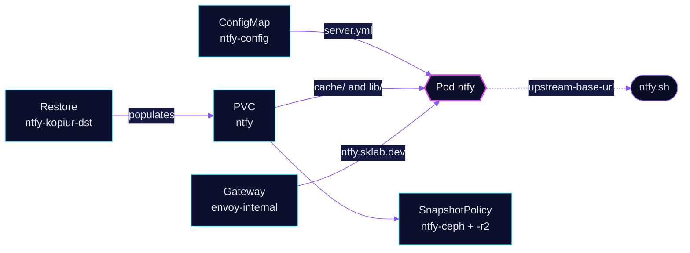

<!-- header: icon=bell-ring -->
<!-- concept: From a publish to a phone | send Publish | server Server | database Cache | smartphone Device -->
<p align="center"></p>

> Self-hosted push notifications: scripts and apps publish to a topic, subscribers get it on their devices.

**Live facts:** <https://skrumbach.github.io/home-ops/apps/selfhosted/ntfy/> (workloads, routes, storage, backups, secrets and alerts, generated on every merge)

## What it does

- **Serves ntfy** at `ntfy.sklab.dev` on `envoy-internal`. There is no SecurityPolicy on the route.
- **Keeps its message cache and user database** on PVC `ntfy`: `cache/` is mounted at `/var/cache/ntfy` and `lib/`
  at `/var/lib/ntfy`.
- **Backs up** that claim with kopiur to `ceph` and the offsite `r2` repositories. A recreated claim is restored
  from the newest ceph snapshot.
- **Takes its configuration** from ConfigMap `ntfy-config`, mounted read-only as `/etc/ntfy/server.yml`.

## How it works

<p align="center"></p>

<details>
<summary><b>Resource graph</b>: every object involved, by name</summary>



</details>

1. Flux applies Kustomization `ntfy` after `kopiur-repository`. The HelmRelease waits for `rook-ceph-cluster`.
   The `kopiur` component adds the SnapshotPolicies and the standing Restore `ntfy-kopiur-dst`; `kopiur/pvc` owns
   the claim.
2. The container runs `ntfy serve` as uid/gid 1000. It reads `server.yml` and listens on port 80.
3. A client publishes to `https://ntfy.sklab.dev/<topic>`. The server caches the message for 12 hours and
   delivers it to current subscribers.
4. Envoy fronts the pod, and the config sets `behind-proxy: true`. The manifest records no reason.

## Settings that matter

Values are in [`app/configmap.yaml`](app/configmap.yaml) unless noted.

| Setting | Value | Why |
|---|---|---|
| `auth-default-access` | `read-write` | Anyone who can reach the route can publish and subscribe to any topic. The manifest records no reason. |
| `upstream-base-url` | `https://ntfy.sh` | The manifest records no reason. |
| `cache-duration` | `12h` | The manifest records no reason. |
| `attachment-total-size-limit`, `-file-size-limit`, `-expiry-duration` | `1G`, `50M`, `24h` | The manifest records no reason. |
| `capabilities.add` ([`app/helmrelease.yaml`](app/helmrelease.yaml)) | `NET_BIND_SERVICE` | `listen-http` defaults to `:80`, and a non-root process needs this to bind it. |
| `KOPIUR_CAPACITY`, `KOPIUR_SCHEDULE_R2` ([overlay](../../../main/selfhosted/ntfy.yaml)) | `2Gi`, `H 14 * * *` | Claim size, and the namespace's r2 hour. Ceph keeps the component default, every 4 hours. |

## Operate it

```bash
flux -n selfhosted get ks ntfy
flux -n selfhosted get hr ntfy
kubectl -n selfhosted get pods -l app.kubernetes.io/name=ntfy -o wide
kubectl -n selfhosted get snapshotpolicy,restore,pvc
kubectl -n selfhosted logs deploy/ntfy --tail=50
```

`system/pvc-mover-readable-check` lists `ntfy` as `UNMEASURED` because the pod mounts the claim only through
`subPath`s; `UNMEASURED` is not a pass.
Restores: [`restore.md`](../../../../../.agents/skills/incident-runbooks/references/restore.md).

Upstream: [ntfy docs](https://docs.ntfy.sh/config/)
