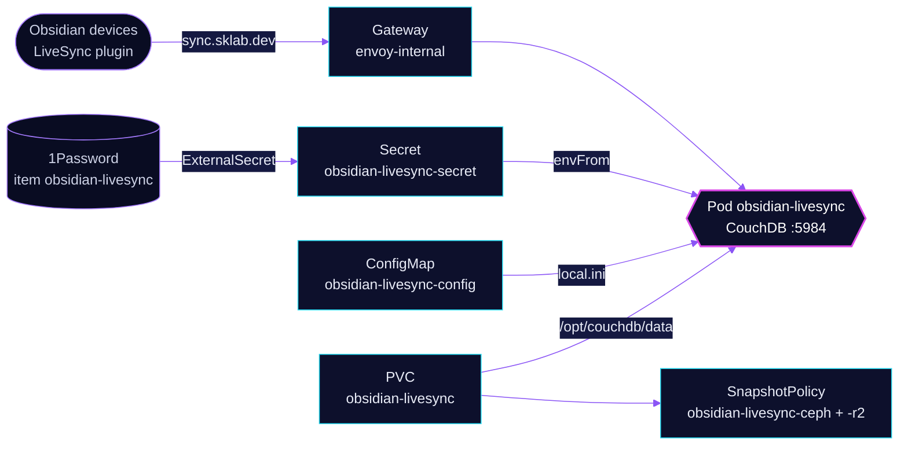

<!-- header: icon=notebook-pen -->
<!-- concept: From a note on one device to every device | notebook-pen Note | refresh-cw Sync | database Store | smartphone Device -->
<p align="center"></p>

> A single-node CouchDB that the Obsidian LiveSync plugin syncs vaults through, internal route only.

**Live facts:** <https://skrumbach.github.io/home-ops/apps/selfhosted/obsidian-livesync/> (workloads, routes, storage, backups, secrets and alerts, generated on every merge)

## What it does

- **Serves CouchDB** at `sync.sklab.dev` on `envoy-internal` only, port `5984`. The Obsidian LiveSync plugin on each
  device replicates a vault into it.
- **Requires a login for every request.** `[chttpd_auth] require_valid_user = true`, with basic auth. The admin
  user comes from 1Password item `obsidian-livesync` (Secret `obsidian-livesync-secret`).
- **Accepts the Obsidian clients' origins** through CORS: `app://obsidian.md`, `capacitor://localhost` and
  `http://localhost`, with credentials.
- **Keeps the data** in PVC `obsidian-livesync` at `/opt/couchdb/data`, backed up by kopiur to `ceph` and `r2`.

## How it works

<p align="center"></p>

<details>
<summary><b>Resource graph</b>: every object involved, by name</summary>



</details>

1. Flux applies Kustomization `obsidian-livesync` after `onepassword-store` and `kopiur-repository`. The
   `kopiur/pvc` component owns PVC `obsidian-livesync`, so a recreated claim is filled from the newest ceph snapshot.
   The HelmRelease waits for `rook-ceph-cluster`.
2. Secret `obsidian-livesync-secret` supplies `COUCHDB_USER`, `COUCHDB_PASSWORD` and `COUCHDB_SECRET`.
3. ConfigMap `obsidian-livesync-config` is mounted read-only as `/opt/couchdb/etc/local.d/local.ini`.
4. A device signs in with basic auth and replicates its vault. The request and document size limits are set in
   `local.ini` (see below).

## Settings that matter

Config values are in [`app/configmap.yaml`](app/configmap.yaml), the rest in [`app/helmrelease.yaml`](app/helmrelease.yaml).

| Setting | Value | Why |
|---|---|---|
| `[couchdb] single_node` | `true` | One replica on one claim, no cluster. The manifest records no further reason. |
| `[chttpd] max_http_request_size` | `4294967296` | The manifest records no reason. |
| `[couchdb] max_document_size` | `50000000` | The manifest records no reason. |
| `[compactions] _default` | `db_fragmentation 70%`, `view_fragmentation 60%` | The manifest records no reason. |
| `[cors] origins`, `credentials` | `app://obsidian.md,capacitor://localhost,http://localhost`, `true` | The origins of the desktop, mobile and local Obsidian clients. |
| `runAsUser`, `runAsGroup`, `fsGroup` | `5984` | The manifest records no reason. The kopiur mover must match it: `KOPIUR_PUID` and `KOPIUR_PGID` are `"5984"` in the overlay. |
| `resources` | requests 250m CPU, 256Mi; limit 512Mi | The manifest records no reason. |
| `KOPIUR_CAPACITY`, `KOPIUR_SCHEDULE_R2` (overlay) | `2Gi`, `H 14 * * *` | Claim size. The offsite copy runs daily in hour 14. Ceph keeps the component default. |

## Operate it

```bash
flux -n selfhosted get ks obsidian-livesync
flux -n selfhosted get hr obsidian-livesync
kubectl -n selfhosted get pods -l app.kubernetes.io/name=obsidian-livesync -o wide
kubectl -n selfhosted logs deploy/obsidian-livesync --tail=50
kubectl -n selfhosted get snapshotpolicy,snapshotschedule,restore,pvc
```

Restores: [`restore.md`](../../../../../.agents/skills/incident-runbooks/references/restore.md).

## Invariants

- The kopiur identity is measured from the files: `KOPIUR_PUID` and `KOPIUR_PGID` stay `"5984"`. Do not fall back to
  1000, or the backup fails closed.
- The Kustomization that owns the kopiur claim never sets `wait: true`.
- The route stays on `envoy-internal`. Nothing here sits in front of CouchDB except its own `require_valid_user`.

Upstream: [Self-hosted LiveSync](https://github.com/vrtmrz/obsidian-livesync) •
[CouchDB docs](https://docs.couchdb.org/en/stable/)
