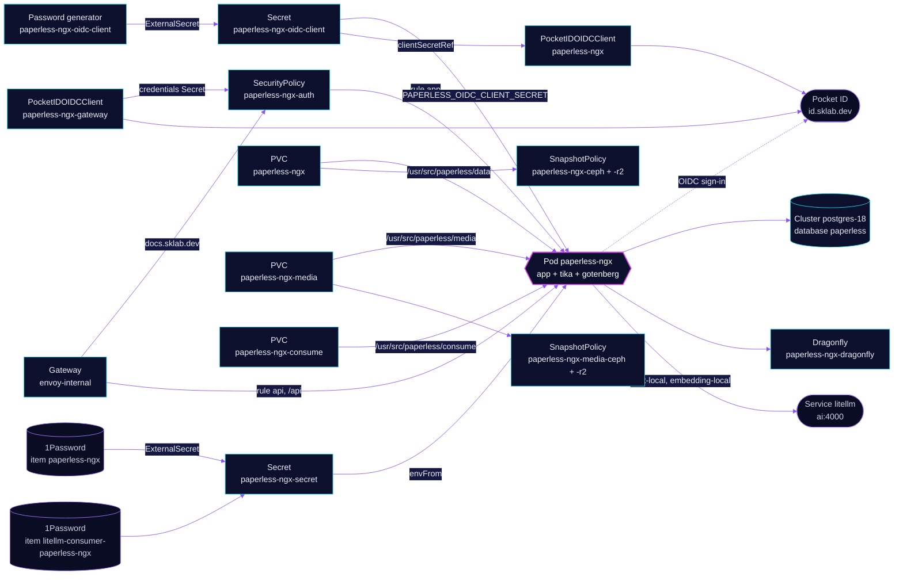

<!-- header: icon=file-text -->
<!-- concept: From a scanned page to a searchable archive | inbox Inbox | scan-text Read | tags Tag | archive Archive | search Search -->
<p align="center"></p>

> The household document archive: OCR, tagging and AI suggestions on local models, behind Pocket ID sign-in.

**Live facts:** <https://skrumbach.github.io/home-ops/apps/selfhosted/paperless-ngx/> (workloads, routes, storage, backups, secrets and alerts, generated on every merge)

## What it does

- **Archives documents** at `docs.sklab.dev` on `envoy-internal` only. It reads the `consume` volume, runs OCR in
  German and English (`PAPERLESS_OCR_LANGUAGE: deu+eng`) and writes a PDF/A archive copy of every document.
- **Handles Office files and e-mail** through two sidecar containers in the same pod, `tika` and `gotenberg`,
  reached over `localhost`. They have no Service.
- **Suggests tags, titles and dates with AI** through `ai/litellm` (`chat-local` and `embedding-local`), using
  Paperless' own virtual key from 1Password item `litellm-consumer-paperless-ngx`.
- **Signs people in with Pocket ID** twice: Envoy gates the browser UI, and Paperless itself runs OIDC as the only
  social provider. `/api` stays outside the Envoy gate.
- **Keeps its state** in PostgreSQL on the shared `postgres-18` Cluster (role and database `paperless`) and in three
  volumes. Two are backed up by kopiur to `ceph` and `r2`.
- **Queues work** in a two-replica Dragonfly, `paperless-ngx-dragonfly`.

## Why it is built this way

| Choice | Why |
|---|---|
| **Two Pocket ID clients, not one** | Rule `app` is gated at Envoy (`paperless-ngx-gateway`, callback `/oauth2/callback`). Paperless' own login is a separate client (`paperless`, callback `/accounts/oidc/pocket-id/login/callback/`), also used by Profile > Connect. |
| **Gate rule `app`, leave rule `api` open** | Mobile apps and scripts cannot follow an SSO redirect. `/api` answers to Paperless' own token, basic and session auth. |
| **The client secret is generated in the cluster** | `paperless-ngx-oidc-client` comes from a `Password` generator, once (`refreshPolicy: CreatedOnce`). Nothing sits in 1Password and nothing rotates it. The operator pushes the value to Pocket ID. |
| **A network policy on ingress only** | Egress stays open to `postgres-18`, Dragonfly, LiteLLM, Pocket ID and DNS. The ingress fence admits the peers' replies without `toPorts` (cilium/cilium#47913). |
| **Two backed-up claims, two Kustomizations** | One kopiur include protects one volume. `paperless-ngx-media-kopiur` covers the scans, which cannot be rebuilt from the database. |

## How it works

<p align="center"></p>

<details>
<summary><b>Resource graph</b>: every object involved, by name</summary>



</details>

1. Flux applies `paperless-ngx-db` first (role and database on `postgres-18`), then `paperless-ngx` after
   `onepassword-store`, `kopiur-repository`, `cloudnative-pg` and `dragonfly-operator`. The overlay includes the
   `kopiur`, `kopiur/pvc` and `dragonfly` components. Kustomization `paperless-ngx-media-kopiur` follows once
   `paperless-ngx` exists. The HelmRelease waits for `rook-ceph-cluster`.
2. The `kopiur/pvc` component owns PVC `paperless-ngx` (`/usr/src/paperless/data`), so a recreated claim is filled
   from the newest ceph snapshot. `media` (`ceph-block`, 50Gi, `retain: true`, so a Helm uninstall keeps it) and `consume`
   (`ceph-block`, 10Gi) are chart-owned claims in the HelmRelease. Only the `app` container mounts them.
3. A file dropped in `consume` is found by polling every 60 seconds (`PAPERLESS_CONSUMER_POLLING`), because Ceph has
   no inotify. Sub-directories become tags (`PAPERLESS_CONSUMER_SUBDIRS_AS_TAGS`). Paperless moves the file into
   `media`, so the inbox needs no backup.
4. Tika and gotenberg turn Office files and `.eml` into PDFs. Gotenberg runs with JavaScript off and a `file:///tmp`
   allow-list, so it fetches no remote content.
5. A person opens `https://docs.sklab.dev`. Envoy sends them to Pocket ID, which admits only the group `admins`
   (both clients set `allowedUserGroups`). Paperless then offers its own "Pocket ID" login. New SSO users are
   created on first login with no permissions; an admin grants them in Paperless.

## Settings that matter

All values are in [`app/helmrelease.yaml`](app/helmrelease.yaml) unless noted.

| Setting | Value | Why |
|---|---|---|
| `PAPERLESS_THREADS_PER_WORKER` | `1` | Unset, Paperless sizes OCR threads from the node's 20 cores, not the 2 CPU limit. About 20 parallel tesseract jobs OOM-killed the pod at 2Gi during the 2026-11-08 re-import. |
| `PAPERLESS_TASK_WORKERS`, `PAPERLESS_WEBSERVER_WORKERS` | `2`, `2` | The manifest records no reason. |
| `resources` (`app`) | requests 250m CPU, 1Gi; limits 2000m CPU, 4Gi | The manifest records no reason. |
| `PAPERLESS_ARCHIVE_FILE_GENERATION` | `always` | A PDF/A archive for every document, as the older instance had. The default `auto` skips born-digital PDFs. |
| `PAPERLESS_DATE_PARSER_LANGUAGES` | `de+en` | German dates parse right in the default DMY order. US numeric dates can misparse, and the AI created-date suggestion corrects them. |
| `PAPERLESS_CONSUMER_DELETE_DUPLICATES` | `"true"` | E-mail and re-scans re-deliver the same file. Exact duplicates are dropped instead of failing. |
| `PAPERLESS_FILENAME_FORMAT` | `{{ created_year }}/{{ correspondent }}/{{ title }}` | Readable layout for new files. Existing files move only with `document_renamer`. The placeholders sit in a raw string because app-template runs values through Helm `tpl`. |
| `PAPERLESS_AI_LLM_MODEL`, `..._EMBEDDING_MODEL` | `chat-local`, `embedding-local` | Role aliases only, never a real model name ([`ai/AGENTS.md`](../../ai/AGENTS.md)). |
| `PAPERLESS_AI_LLM_REQUEST_TIMEOUT` | `"300"` | The local chat model can think before it answers, and 120 seconds is too short for that. |
| `PAPERLESS_AI_LLM_EMBEDDING_CHUNK_SIZE` | `"256"` | `embedding-local` has a 512-token context. At 384, about 1 document in 20 still overflowed (2026-11-08). |
| `PAPERLESS_SOCIALACCOUNT_PROVIDERS` | `provider_id` `pocket-id`, `OAUTH_PKCE_ENABLED: true` | The `provider_id` is part of the client's callback URL: change both together. The secret is filled in as `$(PAPERLESS_OIDC_CLIENT_SECRET)`, which works only for a variable listed before it (`dependsOn`). |
| `gotenberg` and `tika` `securityContext` | uid/gid `1001` and `35002` | Each image's own user. Neither mounts the volumes, because tika (35002) cannot write them. |
| `KOPIUR_CAPACITY`, `KOPIUR_CACHE_CAPACITY` (overlay) | `10Gi`, `10Gi` | Claim size and the mover's ephemeral kopia cache. For `paperless-ngx-media` the cache is `50Gi`, the claim size. The manifest records no reason for the sizes. |
| `KOPIUR_SCHEDULE_R2` (overlay) | `H 14 * * *` | The offsite copy runs daily in hour 14. Ceph keeps the component default. |

## Operate it

```bash
flux -n selfhosted get ks paperless-ngx paperless-ngx-db paperless-ngx-media-kopiur
flux -n selfhosted get hr paperless-ngx
kubectl -n selfhosted get pods -l app.kubernetes.io/name=paperless-ngx -o wide
kubectl -n selfhosted logs deploy/paperless-ngx -c app --tail=50
kubectl -n selfhosted get dragonfly,pvc,snapshotpolicy,snapshotschedule,restore
kubectl -n selfhosted get securitypolicy/paperless-ngx-auth pocketidoidcclient
kubectl -n selfhosted get externalsecret paperless-ngx-secret paperless-ngx-oidc-client
```

Restores: [`restore.md`](../../../../../.agents/skills/incident-runbooks/references/restore.md). The retired VolSync
repository `paperless-ngx` is not `paperless-ngx-media`.

### When an alert fires

Rules are in `system/kopiur`, routed by the `alerts` component.

| Alert | Fires when | First look |
|---|---|---|
| `KopiurBackupStaleCeph` | no recent ceph backup of `paperless-ngx-ceph` or `paperless-ngx-media-ceph` | `kubectl -n selfhosted describe snapshotpolicy <name>`. |
| `KopiurBackupStaleR2` | no recent r2 backup of `paperless-ngx-r2` or `paperless-ngx-media-r2` | Same, for the `-r2` policy. |
| `KopiurBackupEmpty` | the latest backup holds zero files | The claim was empty or unreadable when the snapshot ran. |

## Invariants

- The secret `paperless-ngx-oidc-client` changes only when its ExternalSecret or Secret is deleted. The operator then
  keeps the old value valid for `clientSecretOverlap: 1h` while the pod restarts.
- The `provider_id` `pocket-id` and the client callback URL change together.
- Only rule `app` of the route is gated. Renaming a rule leaves the gate attached to nothing, and the UI is served
  without sign-in (`scripts/ci/securitypolicy-section-name-test.py`).
- The `paperless-ngx-consume` inbox stays out of backups: Paperless deletes files from it once they are ingested.
- One kopiur include covers one volume ([`kopiur/README.md`](../../../../components/kopiur/README.md)). A Kustomization
  that owns a kopiur claim never sets `wait: true`.
- The network policy's selector includes the `controller` label, which keeps the operator-managed
  `paperless-ngx-dragonfly` pods out of it.

Upstream: [Paperless-ngx docs](https://docs.paperless-ngx.com/) •
[Configuration](https://docs.paperless-ngx.com/configuration/) •
[Envoy Gateway OIDC](https://gateway.envoyproxy.io/docs/tasks/security/oidc/)
