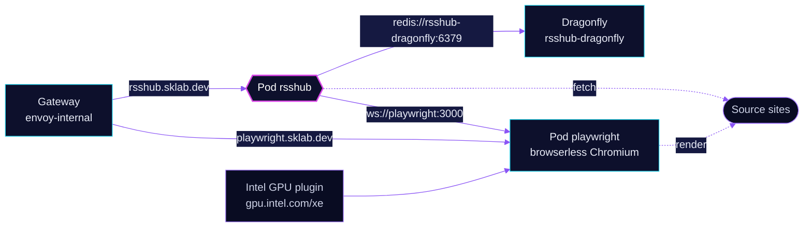

<!-- header: icon=rss -->
<!-- concept: From a web page to a feed | globe Source | chrome Browser | database Cache | rss Feed -->
<p align="center"></p>

> Turns sites that have no feed into RSS feeds, with a Dragonfly cache and a headless browser for pages that need one.

**Live facts:** <https://skrumbach.github.io/home-ops/apps/selfhosted/rsshub/> (workloads, routes, storage, backups, secrets and alerts, generated on every merge)

## What it does

- **Builds feeds** at `rsshub.sklab.dev` on `envoy-internal`. The route has no SecurityPolicy and no homepage tile.
- **Caches** results in Redis protocol (`CACHE_TYPE: redis`) on Dragonfly `rsshub-dragonfly`, from the shared
  `dragonfly` component. The app keeps no volume.
- **Renders JavaScript pages** through a second Flux Kustomization, `rsshub-playwright`, which runs browserless
  Chromium as Deployment `playwright`. The app reaches it through `PUPPETEER_WS_ENDPOINT`.
- **Gives the browser a GPU.** `playwright` requests `gpu.intel.com/xe: 1`, served by the Intel device plugin.

## How it works

<p align="center"></p>

<details>
<summary><b>Resource graph</b>: every object involved, by name</summary>



</details>

1. Flux applies `rsshub-playwright` after `onepassword-store`, `dragonfly-operator` and `intel-device-plugin-gpu`.
   It applies `rsshub` after `onepassword-store`, `dragonfly-operator` and `rsshub-playwright`. The `dragonfly`
   component adds `rsshub-dragonfly` to `rsshub`.
2. `playwright` runs as root with `SYS_ADMIN`. Its `/config`, `/tmp`, `/dev/shm` and `/var/run` are emptyDirs; there
   is no PVC and nothing to back up.
3. `rsshub` starts on port 80 with the `Recreate` strategy, reads its cache from `rsshub-dragonfly:6379` and sends
   browser work to `ws://playwright.selfhosted.svc.cluster.local:3000`.
4. A reader requests a feed path from `rsshub.sklab.dev`. The app serves it from cache, or fetches the source and
   caches the result.

## Settings that matter

| Setting | Value | Why |
|---|---|---|
| `rsshub` `strategy` | `Recreate` | The manifest records no reason. |
| `rsshub` image tag | `latest` plus digest | Renovate limits its digest updates to once a week ([`.renovate/autoMerge.json5`](../../../../../.renovate/autoMerge.json5)): the image rebuilds many times a day. |
| `HOTLINK_TEMPLATE` | `https://rsstt-img-relay-cqf.pages.dev/$${href_ue}` | `$$` escapes the Flux substitution, so the app sees a literal `${href_ue}`. |
| `resources` (`rsshub`) | request 10m CPU, 512Mi; limit 2048Mi | The manifest records no reason. |
| `playwright` `defaultPodOptions.securityContext` | uid, gid and fsGroup `0`, `runAsNonRoot: false` | The manifest records no reason for root. Keep it under `defaultPodOptions` (see Invariants). |
| `playwright` `dev-shm` | emptyDir, `medium: Memory`, `sizeLimit: 1Gi` | The manifest records no reason. |
| `playwright` route annotation | `gatus.home-operations.com/enabled: "false"` | Keeps Gatus off the browserless route. The manifest records no further reason. |

## Operate it

```bash
flux -n selfhosted get ks rsshub rsshub-playwright
flux -n selfhosted get hr rsshub playwright
kubectl -n selfhosted get pods -l app.kubernetes.io/name=rsshub -o wide
kubectl -n selfhosted get pods -l app.kubernetes.io/name=playwright -o wide
kubectl -n selfhosted get dragonfly rsshub-dragonfly
kubectl -n selfhosted get pod -l app.kubernetes.io/name=playwright -o jsonpath='{.items[0].spec.securityContext}'
```

The last command must print a non-empty `securityContext` with `runAsUser: 0`; `{}` means the pod options were
dropped (see Invariants).

## Invariants

- **Pod options go under a key the chart reads.** `selfhostedPodOptions` is not an app-template key, so Helm silently
  discarded that block and the pod ran with an empty `securityContext`: legal YAML, flate passes, HelmRelease green.
  The block now sits under `defaultPodOptions`. The same class of failure is listed in the root `AGENTS.md`
  (workloads tripwire), and `system/pvc-writable-check` names `selfhosted/rsshub-playwright` among the cases of the 2026-08-30 empty-volume audit.
- `playwright` holds no state. Do not add a claim to it; there is no kopiur component on `rsshub-playwright` by design.

Upstream: [RSSHub docs](https://docs.rsshub.app/) •
[browserless](https://docs.browserless.io/)
