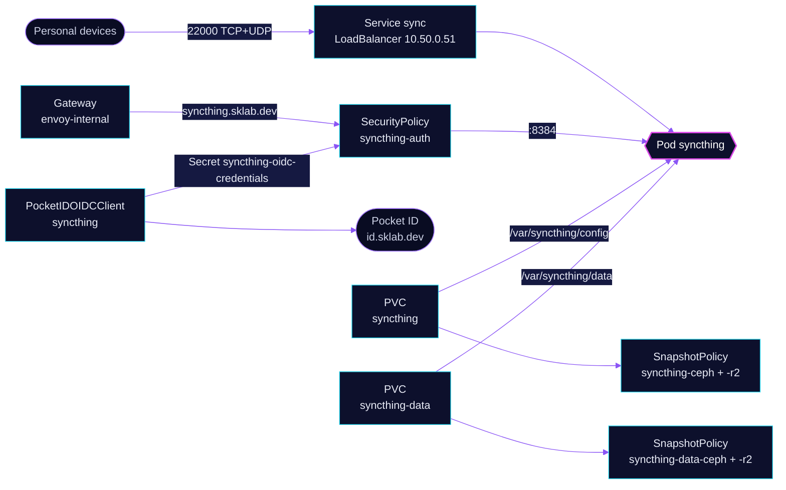

<!-- header: icon=folder-sync -->
<!-- concept: From a folder on a Mac to a copy in the cluster | folder Folder | link Pair | refresh-cw Sync | hard-drive Keep -->
<p align="center"></p>

> Syncs folders between personal devices and the cluster, with the web GUI behind Pocket ID sign-in.

**Live facts:** <https://skrumbach.github.io/home-ops/apps/selfhosted/syncthing/> (workloads, routes, storage, backups, secrets and alerts, generated on every merge)

## What it does

- **Syncs folders** over the `sync` Service (LoadBalancer `10.50.0.51`, port `22000` TCP and UDP). Device sync does
  not use the web route.
- **Serves the web GUI** at `syncthing.sklab.dev` on `envoy-internal` only, gated at Envoy by SecurityPolicy
  `syncthing-auth` with Pocket ID. Only group `admins` passes. The GUI keeps its own password as an inner layer.
- **Keeps its identity and settings** on PVC `syncthing` (`/var/syncthing/config`), and the synced files on PVC
  `syncthing-data` (`/var/syncthing/data`). Both are backed up by kopiur to `ceph` and `r2`.
- **Takes shares and folders from its own config**, not from Git: folder shares and device names live in Syncthing's
  config on the `syncthing` claim. This tree owns the HelmRelease and the `syncthing-data` claim.

## How it works

<p align="center"></p>

<details>
<summary><b>Resource graph</b>: every object involved, by name</summary>



</details>

1. Flux applies Kustomization `syncthing` after `kopiur-repository`. The `kopiur/pvc` component owns PVC `syncthing`;
   [`app/pvc.yaml`](app/pvc.yaml) owns `syncthing-data` (`ceph-block`). Kustomization `syncthing-data-kopiur` backs up
   the second claim. The HelmRelease waits for `rook-ceph-cluster`.
2. The container sets `STHOMEDIR` to `/var/syncthing/config`, `STGUIADDRESS` to `0.0.0.0:8384` and `STDEFAULTFOLDER`
   to `/var/syncthing/data`.
3. Devices pair and transfer through Service `sync`. The web route is only for the GUI.
4. Gatus does not use the route, because the gate would turn the check into the Pocket ID sign-in page. It calls
   `http://syncthing-app.selfhosted.svc.cluster.local:8384/rest/noauth/health` and expects `status` `OK`.

## Settings that matter

All values are in [`app/helmrelease.yaml`](app/helmrelease.yaml) unless noted.

| Setting | Value | Why |
|---|---|---|
| Service `sync` annotation `lbipam.cilium.io/ips` | `10.50.0.51` | A fixed address for device pairing. The manifest records no further reason. |
| `defaultPodOptions.securityContext` | uid/gid/fsGroup `1000`, `OnRootMismatch` | Matches the kopiur mover identity (component default 1000). |
| `syncthing-data` `storage` ([`app/pvc.yaml`](app/pvc.yaml)) | `15Gi` | Sized to the synced folders (Documents, Screenshots, Projects, camera-roll headroom) plus buffer. |
| `KOPIUR_CAPACITY` (overlay) | `1Gi` | The `syncthing` claim: config, identity, pairing. |
| `KOPIUR_CACHE_CAPACITY` (`syncthing-data-kopiur`) | `15Gi` | Claim-sized cache for the data claim. |
| `KOPIUR_SCHEDULE_R2` (overlay, both) | `H 14 * * *` | The offsite copy runs daily in hour 14. Ceph keeps the component default. |
| `resources` | requests 100m CPU, 256Mi; limit 512Mi | The manifest records no reason. |

## Operate it

```bash
flux -n selfhosted get ks syncthing syncthing-data-kopiur
flux -n selfhosted get hr syncthing
kubectl -n selfhosted get pods -l app.kubernetes.io/name=syncthing -o wide
kubectl -n selfhosted get svc -l app.kubernetes.io/name=syncthing
kubectl -n selfhosted get snapshotpolicy,snapshotschedule,restore,pvc
kubectl -n selfhosted get securitypolicy/syncthing-auth pocketidoidcclient/syncthing
```

Restores: [`restore.md`](../../../../../.agents/skills/incident-runbooks/references/restore.md).

## Invariants

Carried over from the earlier README in `app/`, wording unchanged:

- Folder shares and device names live in Syncthing's config on the `syncthing` claim, not in Git. This tree owns the
  HelmRelease and the `syncthing-data` claim.
- `syncthing`, 1Gi: Config, device identity, pairing. Do not resize or delete.
- `syncthing-data`, 15Gi: Synced folder roots under `/var/syncthing/data/`.
- Both claims are backed up by kopiur only; `syncthing-data` left VolSync on 2026-11-01 (issue #2202). Its cache is
  claim-sized (`KOPIUR_CACHE_CAPACITY` 15Gi in the `syncthing-data-kopiur` Kustomization) and must stay at least the
  claim size. Do not delete a kopiur Snapshot CR.
- Folder types last recorded in the app database (confirm with `GET /rest/config/folders` before changing them):
  `documents` and `projects` are sendreceive; `screenshots` and `camera-roll` are receiveonly so a cluster-side delete
  cannot destroy the Mac originals. An empty `id` with path `~` is Syncthing's defaults block, not a folder.
- Accepting a share is a click in the Mac Syncthing UI. Pairing a phone for `camera-roll` is a separate step.
  Kubernetes cannot shrink a PVC.

Also in force:

- The `sync` Service is the only path for device traffic. A policy that fails to translate (for example, the operator
  has not written `syncthing-oidc-credentials` yet) makes the GUI route answer 500.
- The Kustomization that owns a kopiur claim never sets `wait: true`.

Upstream: [Syncthing docs](https://docs.syncthing.net/) •
[Envoy Gateway OIDC](https://gateway.envoyproxy.io/docs/tasks/security/oidc/)
