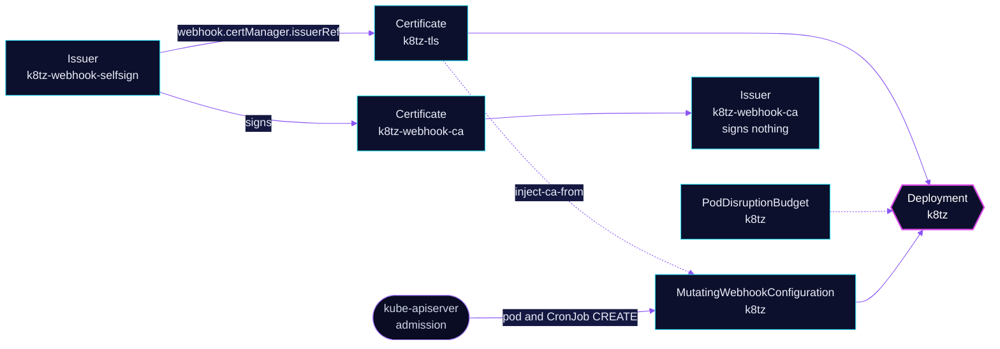

<!-- header: icon=clock -->
<!-- concept: From a webhook to a pod timezone | file-key Webhook cert | shield-check Admission | clock Timezone | box Pod | calendar-clock CronJob -->
<p align="center"></p>

> Admission webhook that sets the America/New_York timezone on pods and CronJobs across the cluster.

**Live facts:** <https://skrumbach.github.io/home-ops/apps/system-controller/k8tz/> (workloads, routes, storage, backups, secrets and alerts, generated on every merge)

## What it does

- **Applies a timezone** through the k8tz admission webhook: `timezone: America/New_York`.
- **Sets CronJob time zones** too (`cronJobTimeZone: true`).
- **Covers every namespace except `system-controller` and `kube-system`.** The chart defaults (`injectAll: true`,
  `webhook.ignoredNamespaces: [kube-system]` plus its own namespace) decide the scope; no value here changes it.
- **Runs two replicas** (`replicaCount: 2`) behind a PodDisruptionBudget, because the webhook sits in the admission
  path.
- **Gets its serving certificate** from cert-manager: the chart's `Certificate` `k8tz-tls`, signed by the self-signed
  `Issuer` `k8tz-webhook-selfsign`.

## Why it is built this way

| Choice | Why |
|---|---|
| **cert-manager, not the chart's built-in certificate** | `webhook.certManager.enabled` makes the chart request `Certificate` `k8tz-tls` and annotate its MutatingWebhookConfiguration with `cert-manager.io/inject-ca-from`, so cert-manager renews the certificate and the CA bundle. The issuer is `k8tz-webhook-selfsign`; the public `ClusterIssuer` is not involved. |
| **2 replicas, `minAvailable: 1`, hostname spread** | The webhook sits in the admission path. The manifest records no further reason. `DoNotSchedule` spread plus the PDB keep a copy on another node during a drain. |
| **`nodeTaintsPolicy: Honor`** | It does not see the current `PreferNoSchedule` taint. |
| **Resource requests equal limits, on every container** | Keeps the pod Guaranteed. The chart's `resources` do not cover the `k8tz-cert-watcher` sidecar, so a postRenderer patch sets it. |
| **`imageVolume` stays off** | It cannot mount `/etc/localtime`. |
| **Chart's Namespace deleted by a postRenderer** | `createNamespace` defaults to true, so the chart renders Namespace `system-controller`. The patch targets every Namespace in the release and deletes it; the overlay's `components/common` provides the namespace. The manifest records no reason. |

## How it works

<p align="center"></p>

<details>
<summary><b>Resource graph</b>: every object involved, by name</summary>



</details>

1. Kustomization `k8tz` waits on `cert-manager/cert-manager` (`dependsOn`).
2. The HelmRelease from `HelmRepository` `k8tz` is installed into `system-controller`. Its `webhook.certManager`
   points at `Issuer` `k8tz-webhook-selfsign`, and the postRenderer removes the chart's Namespace.
3. cert-manager issues the chart's `Certificate` `k8tz-tls` from `k8tz-webhook-selfsign` and injects its CA into
   MutatingWebhookConfiguration `k8tz`. The CA `Certificate` and `Issuer` `k8tz-webhook-ca` are applied but sign
   nothing (see [Known gaps](#known-gaps)).
4. The kube-apiserver calls the webhook on every pod and CronJob `CREATE` in scope, and the webhook applies the
   timezone.

## Settings that matter

| Setting | Value | Why |
|---|---|---|
| `timezone` | `America/New_York` | The manifest records no reason. |
| `cronJobTimeZone` | `true` | The manifest records no reason. |
| `replicaCount` | `2` | See the table above. |
| `initContainerResources` | 100m CPU, 128Mi, request equal to limit | An injected init container must not demote a Guaranteed pod. |
| `resources` | 250m CPU, 64Mi, request equal to limit | Raising only the limit demotes the pod to Burstable. |
| cert-watcher patch | 50m CPU, 64Mi, request equal to limit | Chart `resources` skip it. |
| `affinity` | preferred anti-affinity by hostname | Soft spread. The hard one is `topologySpreadConstraints`. |
| `topologySpreadConstraints` | `maxSkew: 1`, `DoNotSchedule`, `matchLabelKeys: pod-template-hash` | Hard spread per rollout. |

## Operate it

```bash
flux -n system-controller get ks k8tz
kubectl -n system-controller get deploy,pod,pdb -l app.kubernetes.io/name=k8tz -o wide
kubectl -n system-controller get certificate,issuer
kubectl get mutatingwebhookconfiguration | grep -i k8tz
```

## Invariants

- Keep requests equal to limits on the webhook, the init container and the cert-watcher patch, or the pod
  loses its Guaranteed class.

## Known gaps

- **The CA chain is unused.** [`app/issuer.yaml`](app/issuer.yaml) says `Issuer` `k8tz-webhook-ca` issues the
  webhook certificates, but [`app/helmrelease.yaml`](app/helmrelease.yaml) points `webhook.certManager.issuerRef` at
  `k8tz-webhook-selfsign`. The 5-year CA `Certificate` `k8tz-webhook-ca` and its `Issuer` sign nothing.

Upstream: [k8tz/k8tz](https://github.com/k8tz/k8tz)
