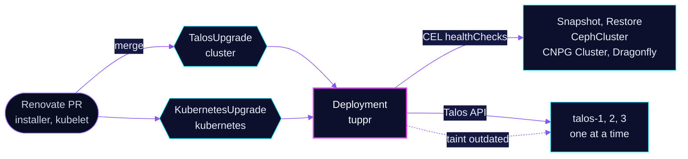

<!-- header: icon=circle-arrow-up -->
<!-- concept: From a version in Git to upgraded nodes | git-pull-request Version | heart-pulse Health gate | server Node | refresh-cw Upgrade | circle-check Verify -->
<p align="center"></p>

> Upgrades Talos and Kubernetes one node at a time from two version pins in Git, gated on Ceph and data-store health.

**Live facts:** <https://skrumbach.github.io/home-ops/apps/system-upgrade/tuppr/> (workloads, routes, storage, backups, secrets and alerts, generated on every merge)

## What it does

- **Upgrades Talos** on the nodes when `TalosUpgrade` `cluster` names a new installer version, rebooting with
  `rebootMode: powercycle`.
- **Upgrades Kubernetes** when `KubernetesUpgrade` `kubernetes` names a new kubelet version.
- **Gates every step** on `healthChecks`: no running kopiur Snapshot, no running Restore, Ceph `HEALTH_OK`, every CNPG
  Cluster at full instance count, every Dragonfly `Ready`.
- **Taints** nodes with `tuppr.home-operations.com/outdated`. Rook tolerates that key with effect `PreferNoSchedule`.
- **Exports** a ServiceMonitor, a PrometheusRule and dashboards (`monitoring.*` set to `enabled`).

## Why it is built this way

| Choice | Why |
|---|---|
| **Version pins in Git, bumped by Renovate** | The `# renovate:` comments over `talosupgrade.yaml` and `kubernetesupgrade.yaml` make a Renovate PR the upgrade request. |
| **`HEALTH_OK` only** | Degraded PGs show as `HEALTH_WARN`. Widening it lets the next node reboot below `min_size`. CI (`version-consistency.sh`) enforces this on both CRs. |
| **Check Snapshot and Restore by phase, not by presence** | Finished CRs accumulate, and tuppr passes only if every object passes. Only an active mover phase (`Running`, `Restoring`) fails. |
| **CNPG and Dragonfly checks** | Data stores must be back to full strength before the next node goes down. |
| **Two operator replicas** | The manifest records no reason. |
| **`system-upgrade` in Talos `allowedKubernetesNamespaces`** | tuppr reaches the Talos API from there. Changing that list is an `apply-node` on all 3 nodes (`talos/machineconfig.yaml.j2`). |

## How it works

<p align="center"></p>

<details>
<summary><b>Resource graph</b>: every object involved, by name</summary>



</details>

1. Flux applies Kustomization `tuppr` (chart, health check on Deployment `tuppr`), then `tuppr-upgrades`
   (`dependsOn` `tuppr`) with the two CRs.
2. Merging a version bump changes the CR. This is an unattended node upgrade.
3. For each node, tuppr evaluates every `healthChecks` entry. Each CEL expression runs per object, all must pass, and
   zero objects pass. Only `object` and `status` are bound, so spec fields go through `object.spec`.
4. tuppr marks nodes with its `tuppr.home-operations.com/outdated` taint. Rook tolerates it explicitly
   (`rook-ceph/rook-ceph/cluster`): an untolerated taint, `PreferNoSchedule` included, makes Rook skip every OSD
   update.
5. `machineconfig.yaml.j2` holds a second copy of the six version pins. `scripts/ci/version-consistency.sh` checks it
   against the two CRs, and says nothing about what the nodes run.

## Settings that matter

| Setting | Value | Why |
|---|---|---|
| `spec.talos.version` | the installer tag in [`talosupgrade.yaml`](upgrades/talosupgrade.yaml) | Renovate-managed (`ghcr.io/siderolabs/installer`), never auto-merged. |
| `spec.kubernetes.version` | the kubelet tag in [`kubernetesupgrade.yaml`](upgrades/kubernetesupgrade.yaml) | Renovate-managed (`ghcr.io/siderolabs/kubelet`), never auto-merged. |
| `policy.rebootMode` | `powercycle` | The manifest records no reason. |
| CephCluster expr | `status.ceph.health in ['HEALTH_OK']` | Never widen it. |
| CNPG expr | `has(status.readyInstances) && status.readyInstances == object.spec.instances` | Full strength. A bare `spec` fails to compile. |
| Dragonfly expr | `has(status.phase) && status.phase == "Ready"` | Full strength. |

## Operate it

```bash
flux -n system-upgrade get ks tuppr tuppr-upgrades
kubectl -n system-upgrade get deploy,pod -l app.kubernetes.io/name=tuppr
kubectl get talosupgrade cluster -o yaml          # status per node
kubectl get kubernetesupgrade kubernetes -o yaml
kubectl get nodes -o wide                          # versions the nodes really run
kubectl get nodes -o custom-columns='NAME:.metadata.name,TAINTS:.spec.taints[*].key'
```

## Invariants

- **A Renovate bump of `talosupgrade.yaml` or `kubernetesupgrade.yaml` is an unattended node upgrade.** Check cluster
  health first.
- **Before any node reboot: `ceph status` is `HEALTH_OK` and `task rook:check-osd-device-paths` is clean, one node
  at a time.** The CEL gate checks Ceph health only, not OSD device paths.
- `talos/*.j2` changes are not applied by Flux. `machineconfig.yaml.j2`'s version pins can drift from the live
  cluster, so applying a stale template can downgrade a node: run `kubectl get nodes -o wide` first.
- Keep `HEALTH_OK` as the only accepted Ceph state in both CRs.
- Keep `system-upgrade` in `allowedKubernetesNamespaces`, or tuppr loses the Talos API.

Upstream: [home-operations/tuppr](https://github.com/home-operations/tuppr)
