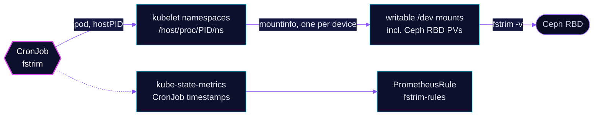

<!-- header: icon=scissors -->
<!-- concept: From a weekly schedule to freed Ceph blocks | calendar-clock Schedule | server Enter node | list-filter Pick mounts | scissors Trim | bell Alert -->
<p align="center"></p>

> Runs `fstrim` once a week on every node's mounted block devices so Ceph reclaims discarded blocks.

**Live facts:** <https://skrumbach.github.io/home-ops/apps/system/fstrim/> (workloads, routes, storage, backups, secrets and alerts, generated on every merge)

## What it does

- **Trims** each writable block-device mount on a node with `fstrim -v`, inside the kubelet's mount and network
  namespaces, so Ceph RBD volumes mounted for pods are covered.
- **Runs weekly** as CronJob `fstrim` in `system` (`0 0 * * 1`).
- **Fails loudly.** The run exits non-zero when any device could not be trimmed, and `FstrimJobFailed` fires on a
  failed run or on no success for 8 days.

## Why it is built this way

| Choice | Why |
|---|---|
| **A privileged pod with `hostPID` and `nsenter`** | The pod finds the kubelet PID and enters its mount namespace. Only there are the pod volumes visible. |
| **One mount per device** | Several mounts can sit on one block device (a globalmount plus bind mounts). The awk filter keeps one per major:minor, ranked globalmount, then whole filesystem, then bind. |
| **No `grep -v kubelet`** | Every Ceph PV is mounted under `/var/lib/kubelet`, so that filter would skip all of them. |
| **`concurrencyPolicy: Forbid` and `activeDeadlineSeconds: 10800`** | A run can outlast its window when many blocks were never discarded. Forbid plus a hung run would block every later run silently, so the deadline ends it. |
| **Alert on schedule vs success, not on failed Jobs** | A failed Job stays in the CronJob history, so `kube_job_status_failed` would latch. The rule compares the latest schedule with the latest success and clears on the next good run. |

## How it works

<p align="center"></p>

<details>
<summary><b>Resource graph</b>: every object involved, by name</summary>



</details>

1. Flux applies Kustomization `fstrim` into `system`: an app-template HelmRelease that renders the CronJob, and the
   PrometheusRule.
2. At Monday 00:00 the Job starts pods with `hostNetwork` and `hostPID`, spread over hostnames
   (`maxSkew: 1`, `DoNotSchedule`).
3. Each pod reads the kubelet PID with `pidof` and runs `nsenter` into that process's mount and network namespaces
   through the host `/proc` mounted at `/host/proc`.
4. `awk` over `/proc/self/mountinfo` keeps mounts whose source is under `/dev/` and which are not read-only, one per
   device.
5. The pod trims each target and prints one line per device. A target that unmounted since discovery is skipped, not
   counted as a failure.

## Settings that matter

All values are in [`app/helmrelease.yaml`](app/helmrelease.yaml).

| Setting | Value | Why |
|---|---|---|
| `schedule` | `0 0 * * 1` | Weekly. The alert window (8 days) is this plus one day. |
| `parallelism` | `3` | The manifest records no reason. |
| `concurrencyPolicy` | `Forbid` | A run can outlast its window. |
| `activeDeadlineSeconds` | `10800` | Equals the `for: 3h` of `FstrimJobFailed`, and ends a hung run. |
| `nodeTaintsPolicy` | `Honor` | Kept so a future hard taint cannot make `DoNotSchedule` refuse a pod. It ignores `PreferNoSchedule`. |
| `securityContext.privileged` | `true` | `nsenter` into the kubelet namespaces and `fstrim` need it. |
| `persistence.procfs` | host `/proc` at `/host/proc`, read-only | Source of the kubelet's namespace files. |
| `resources` | 25m CPU, 128Mi request and limit | Every limit has a request. |

## Operate it

```bash
flux -n system get ks fstrim
kubectl -n system get cronjob,job,pod -l app.kubernetes.io/name=fstrim -o wide
kubectl -n system logs -l app.kubernetes.io/name=fstrim --tail=100   # one line per trimmed device
```

### When an alert fires

From [`app/prometheusrule.yaml`](app/prometheusrule.yaml).

| Alert | Fires when | First look |
|---|---|---|
| `FstrimJobFailed` | the latest run failed, or no success for 8 days, for 3 h | The pod logs above. A suspended CronJob or missed schedules trip the second arm. |

## Invariants

- Never filter mounts with `grep -v kubelet`. Every Ceph PV is under `/var/lib/kubelet`.
- Keep `activeDeadlineSeconds` equal to the alert's `for:` window, or a hung run blocks later runs silently.

## Known gaps

- **Unused mount.** [`app/helmrelease.yaml`](app/helmrelease.yaml) mounts host `/sys` at `/host/net`, and nothing in
  the script reads that path (it uses `/host/proc/<pid>/ns/net`).

Upstream: [fstrim(8)](https://man7.org/linux/man-pages/man8/fstrim.8.html)
