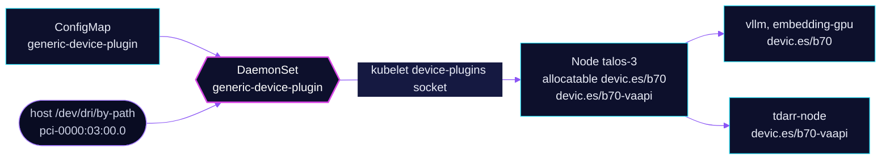

<!-- header: icon=cpu -->
<!-- concept: From a host device node to a schedulable resource | hard-drive Device node | cpu Plugin | tags Resource | calendar-check Schedule | box Pod -->
<p align="center"></p>

> Advertises `/dev/net/tun` and two views of the Arc Pro B70 to the scheduler as `devic.es/*` resources.

**Live facts:** <https://skrumbach.github.io/home-ops/apps/system/generic-device-plugin/> (workloads, routes, storage, backups, secrets and alerts, generated on every merge)

## What it does

- **Registers** three kubelet device-plugin resources from [`app/resources/config.yaml`](app/resources/config.yaml):
  `devic.es/tun`, `devic.es/b70` and `devic.es/b70-vaapi`.
- **Places pods.** A pod that requests `devic.es/b70` or `devic.es/b70-vaapi` can only land on the node that
  advertises it, talos-3. No hostname affinity is needed.
- **Shares one card.** `b70` and `b70-vaapi` each offer 99 identical tokens, so many pods can hold the same GPU.
- **Mounts device nodes** into the pod, with a chosen name inside the container.

Consumers (`git grep devic.es/`): `ai/vllm` and `ai/embedding-gpu` request `devic.es/b70`; `media/tdarr`
(`tdarr-node`) requests `devic.es/b70-vaapi`. No manifest requests `devic.es/tun`.

## Why it is built this way

| Choice | Why |
|---|---|
| **Two resources for one card** | `b70` renames the nodes to `card0` and `renderD128` for Level Zero. That rename kills VA-API, because libdrm reopens the kernel `DEVNAME`. `b70-vaapi` keeps `card1` and `renderD129`. |
| **99 tokens, not 1** | The resource is a share token. Several pods use the card at once (the chat and embedding workloads). |
| **`--domain=devic.es`** | The pinned image defaults to `squat.ai`. The flag makes consumers' `devic.es/...` requests match allocatable capacity. |
| **Hashed ConfigMap name** | The config is mounted by `subPath`, which kubelet never refreshes. A new content hash renames the ConfigMap, `kustomizeconfig.yaml` rewrites the HelmRelease reference, and the DaemonSet rolls. |
| **`system-node-critical`** | The manifest records no reason. |

## How it works

<p align="center"></p>

<details>
<summary><b>Resource graph</b>: every object involved, by name</summary>



</details>

1. Flux applies Kustomization `generic-device-plugin` into `system`. Kustomize generates the ConfigMap with a
   content hash and rewrites the HelmRelease's `persistence.config.name`.
2. The DaemonSet mounts host `/dev` and `/sys` read-only, plus `/var/lib/kubelet/device-plugins` writable, and
   registers each device group with the kubelet.
3. A device whose host path is missing on a node is not advertised there. The `by-path` names point at PCI
   address `0000:03:00.0`.
4. When a pod is admitted with a `devic.es/...` request, the plugin hands the kubelet the mounts for that group.
5. If talos-3 loses the card, allocatable `devic.es/b70` drops to 0 and the `B70GpuLost` alert in
   `monitoring/kube-prometheus-stack` fires (see its [`gpu-loss.yaml`](../../monitoring/kube-prometheus-stack/app/alerts/gpu-loss.yaml)).

## Settings that matter

| Setting | Value | Why |
|---|---|---|
| `b70` paths | `card` to `/dev/dri/card0`, `render` to `/dev/dri/renderD128` | Level Zero expects these names. |
| `b70-vaapi` paths | `card` to `/dev/dri/card1`, `render` to `/dev/dri/renderD129` | Kernel names, which VA-API needs. |
| `count` | `99` per b70 group, `1000` for `tun` | Share tokens. The manifest records no reason for the numbers. |
| ConfigMap name hash | enabled ([`app/kustomization.yaml`](app/kustomization.yaml)) | See the table above. |
| `tolerations` | `home-operations.com/dedicated` `PreferNoSchedule` | Hygiene. `PreferNoSchedule` does not filter, and talos-3 is the only node that can serve the B70. |
| `resources` | 10m CPU; 32Mi request, 64Mi limit | Every limit has a request. |

## Operate it

```bash
flux -n system get ks generic-device-plugin
kubectl -n system get ds generic-device-plugin -o wide
kubectl get nodes -o custom-columns='NAME:.metadata.name,B70:.status.allocatable.devic\.es/b70,VAAPI:.status.allocatable.devic\.es/b70-vaapi'
kubectl -n system logs ds/generic-device-plugin --tail=50
# After any GPU change, the VA-API check (needs exec):
kubectl -n media exec deploy/tdarr-tdarr-node -c app -- vainfo --display drm --device /dev/dri/renderD129
```

Expect 99 on talos-3 for each B70 resource. If it is 0, a host reboot does not bring the card back: power talos-3
fully off, switch the dock PSU on first, then power the host (the alert's text in `gpu-loss.yaml`).

## Invariants

- Never rename a DRM device node with `generic-device-plugin`'s `mountPath`, and never ship a GPU change without
  the VA-API check. VA-API consumers use `devic.es/b70-vaapi`.
- Do not edit the `b70` paths. Device IDs are `sha1(count + host paths)`, so editing them changes all 99 IDs.

## Known gaps

- **Missing skill.** [`app/resources/config.yaml`](app/resources/config.yaml) says "See skill intel-gpu" twice, and
  `.agents/skills/` holds only `incident-runbooks`.
- **Unused resource.** `devic.es/tun` is advertised, and no manifest in `kubernetes/` requests it.

Upstream: [squat/generic-device-plugin](https://github.com/squat/generic-device-plugin)
