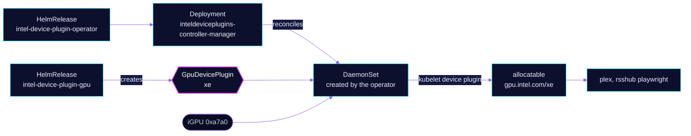

<!-- header: icon=microchip -->
<!-- concept: From an operator to an iGPU resource | package Operator | file-cog Plugin CR | cpu iGPU | tags Resource | box Pod -->
<p align="center"></p>

> Runs Intel's device-plugin operator and one GpuDevicePlugin that offers the nodes' iGPUs as `gpu.intel.com/xe`.

**Live facts:** <https://skrumbach.github.io/home-ops/apps/system/intel-device-plugin-operator/> (workloads, routes, storage, backups, secrets and alerts, generated on every merge)

## What it does

- **Installs the operator** (`inteldeviceplugins-controller-manager`) with its GPU controller enabled
  (`manager.devices.gpu: true`).
- **Declares** a cluster-scoped `GpuDevicePlugin` named `xe` through the `intel-device-plugin-gpu` HelmRelease. The
  operator turns it into a DaemonSet.
- **Advertises** `gpu.intel.com/xe` on nodes labelled `intel.feature.node.kubernetes.io/gpu=true`. With
  `sharedDevNum: 99`, up to 99 pods can share one iGPU.
- **Serves the iGPU only.** `allowIDs: "0xa7a0"` limits the pool to that device ID. The B70 is not in it.

Consumers (`git grep gpu.intel.com/xe`): `media/plex` and `selfhosted/rsshub` (playwright). Their Kustomizations
depend on `intel-device-plugin-gpu`, and so does `media/tdarr`.

## Why it is built this way

| Choice | Why |
|---|---|
| **Two Kustomizations, `intel-device-plugin-operator` then `intel-device-plugin-gpu`** | The `GpuDevicePlugin` CRD comes from the operator chart, so the CR waits on it (`dependsOn`). |
| **Health on the CR, not the DaemonSet** | The operator creates the DaemonSet dynamically. The CR's `desiredNumberScheduled == numberReady` is the real signal. |
| **`nodeFeatureRule: false`** | The chart's default node selector label is set by hand in Talos `nodeLabels` (`talos/machineconfig.yaml.j2`), not by NFD. |
| **`allowIDs: "0xa7a0"`** | The B70 is served by `generic-device-plugin` under `devic.es/b70` and `devic.es/b70-vaapi`. Letting this plugin claim it too would give two owners for one card. |
| **A `HelmRepository`, not OCI** | Intel publishes no OCI chart. Both HelmReleases use `HelmRepository` `intel`. |

## How it works

<p align="center"></p>

<details>
<summary><b>Resource graph</b>: every object involved, by name</summary>



</details>

1. Flux applies `intel-device-plugin-operator`: the `intel` HelmRepository and the operator chart. Its health check
   waits for the controller Deployment.
2. `intel-device-plugin-gpu` (`dependsOn` the first) installs the `intel-device-plugins-gpu` chart, which creates
   the `GpuDevicePlugin` `xe`.
3. The operator starts a plugin DaemonSet on nodes matching the chart's node selector.
4. The plugin registers `gpu.intel.com/xe` with the kubelet. Pods that request it get the render node.
5. The `XeGpuLost` alert (in `monitoring/kube-prometheus-stack`, [`gpu-loss.yaml`](../../monitoring/kube-prometheus-stack/app/alerts/gpu-loss.yaml))
   fires when a node advertising the resource drops it to 0.

## Settings that matter

| Setting | Value | Why |
|---|---|---|
| `name` | `xe` | Name of the `GpuDevicePlugin`. The Kustomization's health check names it. |
| `sharedDevNum` | `99` | Up to 99 pods share each iGPU. The manifest records no reason for the number. |
| `allowIDs` | `"0xa7a0"` | iGPU only. B70 consumers use `devic.es/b70` and `devic.es/b70-vaapi`. |
| `nodeFeatureRule` | `false` | The node label is a hand-set Talos `nodeLabel`, not NFD. |
| `tolerations` | `home-operations.com/dedicated` `PreferNoSchedule` | Hygiene under `PreferNoSchedule`. |
| `healthCheckExprs` | `desiredNumberScheduled == numberReady` | The CR's own rollout counts. |

## Operate it

```bash
flux -n system get ks intel-device-plugin-operator intel-device-plugin-gpu
kubectl get gpudeviceplugin xe
kubectl -n system get deploy inteldeviceplugins-controller-manager
kubectl get nodes -o custom-columns='NAME:.metadata.name,XE:.status.allocatable.gpu\.intel\.com/xe'
```

### When an alert fires

| Alert | Fires when | First look |
|---|---|---|
| `XeGpuLost` | a node's allocatable `gpu.intel.com/xe` is 0 for 5 min | The `GpuDevicePlugin` status, then GPU pods stuck Pending. |

## Invariants

- This pool is the iGPU only. Do not widen `allowIDs` to the B70.

## Known gaps

- **Dependency without a request.** Kustomization `tdarr` ([`main/media/tdarr.yaml`](../../../main/media/tdarr.yaml))
  `dependsOn` `intel-device-plugin-gpu`, and no `tdarr` manifest requests `gpu.intel.com/xe`. Its worker uses
  `devic.es/b70-vaapi`.

Upstream: [intel/intel-device-plugins-for-kubernetes](https://github.com/intel/intel-device-plugins-for-kubernetes)
