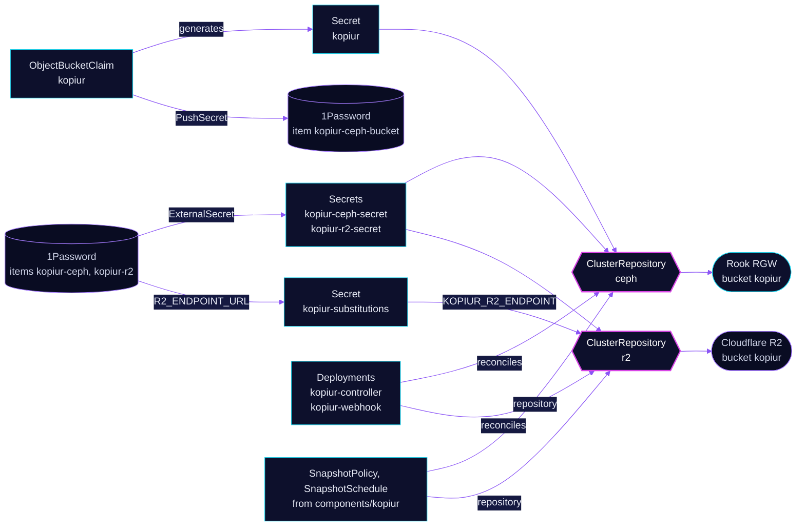

<!-- header: icon=database-backup -->
<!-- concept: From a volume to two backup copies and back | camera Snapshot | lock Encrypt | hard-drive Local copy | cloud Offsite copy | rotate-ccw Restore -->
<p align="center"></p>

> The cluster's only backup engine: the kopiur operator and its two repositories, `ceph` (local) and `r2` (offsite).

**Live facts:** <https://skrumbach.github.io/home-ops/apps/system/kopiur/> (workloads, routes, storage, backups, secrets and alerts, generated on every merge)

## What it does

- **Runs the operator** (Deployments `kopiur-controller` and `kopiur-webhook`, two replicas each) that turns
  `SnapshotPolicy`, `SnapshotSchedule` and `Restore` objects into mover jobs.
- **Defines two destinations** as `ClusterRepository` objects usable from every namespace: `ceph` (the in-cluster
  RGW bucket `kopiur`) and `r2` (an offsite Cloudflare R2 bucket, also named `kopiur`).
- **Provisions the local backend**: `ObjectBucketClaim` `kopiur` on `ceph-bucket`, and `CephObjectStoreUser` `kopiur`
  with a 500G quota.
- **Feeds the repositories their credentials** from 1Password through ExternalSecrets `kopiur-ceph` and `kopiur-r2`.
- **Watches itself** with `KopiurComponentAbsent` and its siblings, because the chart's own alerts go silent when
  the operator disappears.

Per-claim policies and schedules are not here. They come from the `components/kopiur` component, documented in
[`kubernetes/components/kopiur/README.md`](../../../../components/kopiur/README.md).

## Why it is built this way

| Choice | Why |
|---|---|
| **Two repositories, one local and one offsite** | `ceph` stays in the cluster and is written every 4 hours. `r2` survives a Ceph data loss. A whole-cluster restore reads `r2`. |
| **Two Flux Kustomizations, `kopiur` then `kopiur-repository`** | The webhook runs `failurePolicy: Fail`. Until the operator is up, the API server rejects the `ClusterRepository` objects outright, and the CRDs must exist first anyway. |
| **Two replicas, a PDB and a topology spread, for the controller and the webhook** | Talos rolls drain one node at a time. A single evicted webhook blocks every kopiur CR write. Without the spread, both replicas ran on `talos-1` on 2026-11-13. |
| **No wait, `healthChecks` on the two Deployments** | A HelmRelease Ready only reports that the last helm action succeeded. Flux ignores `healthChecks` when `wait` is true. |
| **`crds: CreateReplace` on install and upgrade** | Helm never updates a CRD schema from `crds/`. Without it, a chart bump that adds a field is silently pruned and every policy is refused. kopiur 0.10.0 shipped exactly that shape. |
| **`installScope: cluster`** | A namespaced install swaps the ClusterRole for a Role, which silently stops `ClusterRepository` objects from reconciling. Both repositories are that kind. |
| **R2 endpoint substituted from a Secret** | home-ops is a public repo and the R2 account id is committed nowhere. ExternalSecret `kopiur-substitutions` strips the scheme from 1Password item `kopiur-r2`, and `kopiur-repository` reads it with `substituteFrom`. |
| **Pinned tag, never auto-merged** | kopiur is an alpha API that breaks its user-facing surface often. See the kopiur rule in [`.renovate/autoMerge.json5`](../../../../../.renovate/autoMerge.json5). |

## How it works

<p align="center"></p>

<details>
<summary><b>Resource graph</b>: every object involved, by name</summary>



</details>

1. Flux applies Kustomization `kopiur` after `onepassword-store` (security) and `snapshot-controller` (kube-system).
   It installs the HelmRelease, the OBC, the CephObjectStoreUser, the PushSecret, `kopiur-substitutions` and the
   `kopiur-absent` PrometheusRule.
2. Rook turns the OBC into Secret `kopiur` with the S3 keys. The PushSecret records them in 1Password item
   `kopiur-ceph-bucket`, which is a record only: nothing reads it back.
3. Kustomization `kopiur-repository` then applies the two ExternalSecrets and the two `ClusterRepository` objects. The
   `ceph` repository bootstraps an absent repository and only connects to an existing one (`create.enabled: true`;
   Rook creates the bucket through the OBC). The `r2` repository only
   connects (`create.enabled: false`), so it can never initialise over the offsite copy.
4. An app's overlay includes `components/kopiur` and `dependsOn` `kopiur-repository`. Its `SnapshotPolicy` takes a CSI
   VolumeSnapshot (`copyMethod: Snapshot`), a mover job reads the clone and writes encrypted kopia blobs to the
   repository.
5. Credentials reach a mover through credential projection, which has three legs: the HelmRelease feature, `allowed`
   on each `ClusterRepository`, and `enabled` on each policy and `Restore`. A missed leg leaves the CRs green and the
   mover failing at run time.
6. A restore reads the newest snapshot (`Restore` with `fromPolicy`) or, after Ceph data loss, the `r2` repository.
   The steps are in the runbook below.

## Settings that matter

| Setting | Value | Why |
|---|---|---|
| `installScope` | `cluster` | See above: a namespaced install stops reconciling `ClusterRepository`. |
| `features.credentialProjection.enabled` | `true` | Needs the other two legs. The manifest cites a decision dated 2026-08-30, key `credential-scope`. |
| `replicaCount`, `webhook.replicaCount` | `2` each | A node drain must not take the webhook down. |
| `resources.limits.memory` | `2Gi`, no CPU limit | A limit below the controller's startup burst OOM-loops it, which is why the chart ships none. 2Gi is the ceiling the largest adopter runs. |
| `podSecurityContext`, `securityContext` | non-root 65534, read-only root, drop `ALL` | Pinned to the chart's hardened defaults so a chart change cannot loosen them quietly. |
| `deletionProtection.threshold` | `10` on both | Mass-deletion breaker: external Snapshot deletes are held until a human acks. |
| `onNamespaceDelete` | `Orphan` on both | Deleting a consuming namespace leaves its snapshots in the repository. |
| `ceph` `parameters.epoch.minDuration` | `4h` | The manifest says not to restore kopia's 24h default and not to round to 6h. |
| `r2` epoch | untuned | Its daily cadence accumulates slower. Re-derive the band before raising it. |
| `CephObjectStoreUser` quotas | `500G`, 1,000,000 objects, 10 buckets | Headroom. The manifest warns not to copy VolSync's 20G quota, which was already exceeded. |
| OBC annotation | `kustomize.toolkit.fluxcd.io/prune: disabled` | `ceph-bucket` has reclaimPolicy Delete: deleting the claim deletes the Ceph copy of every backup. This stops Flux only, not `kubectl delete obc` or a namespace delete. |
| PushSecret `deletionPolicy` | `None` | Removing the PushSecret must not delete the 1Password record. |

## Operate it

```bash
flux -n system get ks kopiur kopiur-repository
kubectl -n system get deploy,pdb -l app.kubernetes.io/name=kopiur
kubectl get clusterrepository                     # ceph and r2 Ready
kubectl get snapshotpolicy,snapshotschedule,restore -A
kubectl get snapshot -A                           # one row per kopia snapshot
kubectl -n system get externalsecret kopiur-ceph kopiur-r2 kopiur-substitutions
```

`SecretSynced` does not mean the value is non-empty. Restores of a whole cluster, one claim or a retired VolSync
repository: [`restore.md`](../../../../../.agents/skills/incident-runbooks/references/restore.md).

### Upgrades

[`app/ocirepository.yaml`](app/ocirepository.yaml) points here. The chart tag is exact, never floating, and Renovate
never auto-merges a kopiur chart or image bump (the kopiur rule in
[`.renovate/autoMerge.json5`](../../../../../.renovate/autoMerge.json5)): an unattended CRD change can refuse every
backup. Read the upstream upgrade notes before merging one. `crds: CreateReplace` then applies the new CRD schemas.

### When an alert fires

The chart ships its own group `kopiur.rules`. These come from [`app/prometheusrule.yaml`](app/prometheusrule.yaml).

| Alert | Fires when | First look |
|---|---|---|
| `KopiurComponentAbsent` | the controller target is gone for 5 min | The chart's own alerts are silent now. Check Deployment `kopiur-controller`. |
| `KopiurWebhookAbsent` | the webhook target is gone for 5 min | Every kopiur CR write is rejected, so backups cannot be scheduled. Check `kopiur-webhook`. |
| `KopiurProjectedCredentialsLeaking` | projected credential Secrets stay live across two sweeps | Repository credentials may sit in an app namespace. Look for leftover Secrets from mover runs. |
| `KopiurBackupEmpty` | the latest successful backup has 0 files | The volume was empty or unreadable. A near-empty volume still passes; compare `.status.stats` with what the app should hold. |
| `KopiurBackupStaleCeph` | no successful `*-ceph` backup in 6h | Chart default is 48h. The selector is the policy-name suffix, because the metric has no repository label. |
| `KopiurBackupStaleR2` | no successful `*-r2` backup in 48h | Check the mover Job and the `r2` repository status. |
| `KopiurPolicyVanished` | a policy's last-success series existed 24h ago and does not now | Staleness alerts can no longer fire for that claim. Find out why the policy is gone. |

## Invariants

- `r2` is `create.enabled: false`. It must attach to the existing bucket.
  `ceph` may create its bucket.
- `ClusterRepository.spec.parameters` is write-only from Git. Removing the
  block does not roll the live repository back.
- Do not commit `takeoverPolicy: Force`. `IndexBlobHealth=False` is epoch
  tuning. `ceph` `minDuration` is `4h`. `r2` is untuned.
- 1Password item `kopiur-ceph-bucket` is a record nothing reads. The OBC
  Secret is what the controller uses.

Restores: `.agents/skills/incident-runbooks/references/restore.md`.

## Known gaps

- **The `CephObjectStoreUser` quota does not bound the bucket.** Nothing references `CephObjectStoreUser` `kopiur`
  ([`backend/cephobjectstoreuser.yaml`](backend/cephobjectstoreuser.yaml)) or its Secret. `ClusterRepository` `ceph`
  authenticates with the OBC's Secret `kopiur`, and the OBC sets no `bucketOwner`, so the bucket belongs to the user
  Rook creates for the claim and the 500G quota applies to an idle user.

Upstream: [kopia docs](https://kopia.io/docs/)
