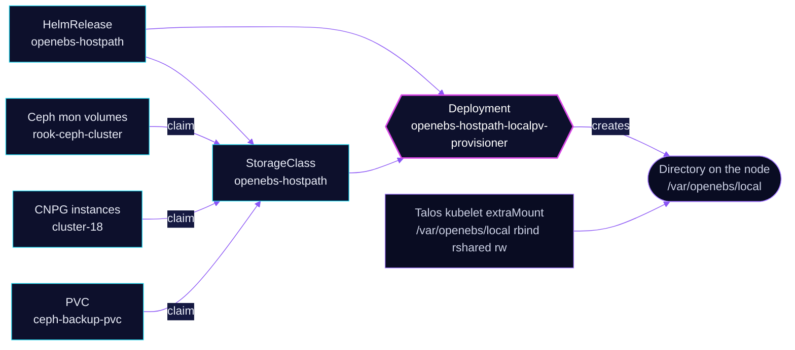

<!-- header: icon=hard-drive -->
<!-- concept: From a claim to a directory on one node | file-text Claim | server Node | folder-tree Directory | pin Pinned -->
<p align="center"></p>

> Provides the node-local `openebs-hostpath` StorageClass used by the Ceph mons, CNPG and the Ceph metadata backup.

**Live facts:** <https://skrumbach.github.io/home-ops/apps/system/openebs-hostpath/> (workloads, routes, storage, backups, secrets and alerts, generated on every merge)

## What it does

- **Provisions volumes as directories** under `/var/openebs/local` on the node that runs the pod, through the Local PV
  provisioner (Deployment `openebs-hostpath-localpv-provisioner`).
- **Creates one StorageClass**, `openebs-hostpath`, and does not make it the default.
- **Backs three consumers**: the Ceph mon volumes (`rook-ceph-cluster`), the CloudNativePG `cluster-18` instances,
  and the `ceph-backup-pvc` claim of the Ceph metadata backup.
- **Does nothing else.** Every other OpenEBS engine in the umbrella chart is switched off.

## Why it is built this way

| Choice | Why |
|---|---|
| **Hostpath for the Ceph mons** | The manifest records no reason. |
| **Hostpath for Postgres** | `cluster-18` says Postgres replicates to the other two instances and archives WAL, so Ceph's 3 copies underneath would be 9 copies in total. |
| **Not the default class** | `isDefaultClass: false`. A claim must name `openebs-hostpath` explicitly. |
| **The umbrella chart with almost everything off** | The chart bundles ZFS, LVM, Mayastor, Loki, Alloy and MinIO. All are `enabled: false` here, and the CRD bundle's `volumeSnapshots` is off. The manifest records no reason. |
| **`disableHooks: true` on install and upgrade** | The manifest records no reason. |

## How it works

<p align="center"></p>

<details>
<summary><b>Resource graph</b>: every object involved, by name</summary>



</details>

1. Flux applies Kustomization `openebs-hostpath` into `system` and waits on the provisioner Deployment through
   `healthChecks`. Kustomizations `rook-ceph-cluster` and `postgres-cluster-18` list `openebs-hostpath` in `dependsOn`.
2. The chart's `basePath` is `/var/openebs/local`, set once as a YAML anchor for both the provisioner and the class.
3. [`talos/machineconfig.yaml.j2`](../../../../../talos/machineconfig.yaml.j2) bind-mounts the same path into the kubelet
   (`rbind`, `rshared`, `rw`). Talos templates are not applied by Flux.
4. A claim becomes a directory under `basePath` on one node. A pod using it cannot move to another node without
   losing the data, which is why `cluster-18` notes that a drained node's instance stays `Pending`.

## Settings that matter

| Setting | Value | Why |
|---|---|---|
| `localpv-provisioner.localpv.basePath` and `hostpathClass.basePath` | `/var/openebs/local` | One anchor, so the provisioner and the class cannot drift apart. It must match the kubelet extraMount in the Talos template. |
| `hostpathClass.isDefaultClass` | `false` | No claim lands here by accident. |
| `engines.local.lvm`, `engines.local.zfs`, `engines.replicated.mayastor` | `enabled: false` | Only the hostpath engine is used. |
| `zfs-localpv`, `lvm-localpv`, `mayastor`, `loki`, `alloy`, `minio` | `enabled: false` | The umbrella chart's other components are off. |

## Operate it

```bash
flux -n system get ks openebs-hostpath
kubectl -n system get deploy openebs-hostpath-localpv-provisioner
kubectl get storageclass openebs-hostpath
kubectl get pv -o custom-columns=NAME:.metadata.name,CLASS:.spec.storageClassName,NODE:.spec.nodeAffinity.required.nodeSelectorTerms[0].matchExpressions[0].values[0] \
  | grep openebs-hostpath
```

## Invariants

- The Ceph metadata backup claim `ceph-backup-pvc` sits on this class. A host wipe destroys it. Emergency steps:
  [`RECOVERY-PROCEDURES.md`](../../rook-ceph/rook-ceph/backup/RECOVERY-PROCEDURES.md).
- A claim here is pinned to one node. `cluster-18` notes a drained node's instance stays `Pending` until that node
  returns.
- The class has no quota. `cluster-18` relies on the `NodeFilesystem*` alerts for `/var`.
