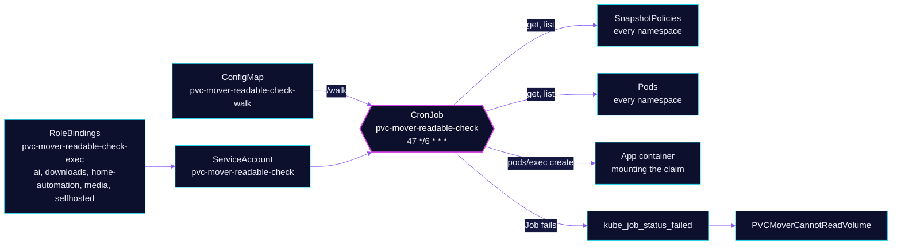

<!-- header: icon=folder-search -->
<!-- concept: From a claim to a verdict on whether the backup can read it | list-checks Discover | user-round Identity | footprints Walk | siren Verdict -->
<p align="center"></p>

> Every 6 hours, proves that each kopiur mover identity can read the claim it backs up, before kopia fails closed.

**Live facts:** <https://skrumbach.github.io/home-ops/apps/system/pvc-mover-readable-check/> (workloads, routes, storage, backups, secrets and alerts, generated on every merge)

## What it does

- **Reads the live `SnapshotPolicy` objects** for the user and group each mover runs as. Identity comes from the live
  `SnapshotPolicy`, never from the component default.
- **Walks each claim** through `kubectl exec` into a running container that mounts the volume root. The script
  `resources/walk.sh` uses only `find` and `stat`, and counts files and directories the mover identity cannot read
  or traverse.
- **Fails the Job** when a mover cannot read, or when a walk is `INCONCLUSIVE`. The alert `PVCMoverCannotReadVolume`
  follows the failed Job.
- **Reports gaps as `UNMEASURED`**, never as a pass.

## Why it is built this way

| Choice | Why |
|---|---|
| **Identity from the live policies** | `KOPIUR_PUID` and `KOPIUR_PGID` are overridden per claim and range from 0 to 10000 across the fleet. A component-default identity would measure the wrong thing and report a false clean. |
| **A walk inside the app's own container** | The check needs a container that already mounts the claim. It runs the walker as that container's identity, over `kubectl exec -i ... -- sh -s`. |
| **Read-only walker** | `find` and `stat` only. It never writes, chowns or chmods, so it is safe against live data. |
| **Two policies that disagree are a finding** | A claim has a ceph and an r2 `SnapshotPolicy`. If they name different identities, one destination reads as an identity nobody verified. |
| **A hashed ConfigMap for `walk.sh`** | The name-suffix hash stays on so the CronJob picks up an edited walker on the next run instead of a stale ConfigMap. |
| **No `targetNamespace` on the overlay** | Flux would rewrite `metadata.namespace` and collapse every RoleBinding into `system`. |

## How it works

<p align="center"></p>

<details>
<summary><b>Resource graph</b>: every object involved, by name</summary>



</details>

1. Flux applies Kustomization `pvc-mover-readable-check`: the ServiceAccount, two ClusterRoles, the CronJob, the
   PrometheusRule and the generated ConfigMap. The ClusterRole `-read` gets `pods` and `snapshotpolicies` cluster-wide.
   The ClusterRole `-exec` is bound by a RoleBinding per namespace, not cluster-wide.
2. The CronJob runs at minute 47 every 6 hours (`concurrencyPolicy: Forbid`, one retry, `activeDeadlineSeconds: 900`).
   It lists `SnapshotPolicy` objects and pods. An empty or failed discovery is `FATAL`, never a quiet pass.
3. For each claim, the first running container that exposes the volume root is walked. A `subPath` mount cannot see
   the volume root, so it never stands in for one.
4. The sweep prints `OK`, `FINDING`, `INCONCLUSIVE` or `UNMEASURED` per claim and a summary. It exits 1 on a finding or an
   inconclusive walk. kube-state-metrics turns that into `kube_job_status_failed`.

## Settings that matter

| Setting | Value | Why |
|---|---|---|
| `schedule` | `47 */6 * * *` | Every 6 hours, matching `pvc-writable-check`. |
| `EXCLUDED_NAMESPACES` | `database` | Must match the namespaces with no `pvc-mover-readable-check-exec` RoleBinding in `rbac.yaml`, so the exclusion is by API-server denial and not by script only. |
| `EXEC_TIMEOUT` | `180` | Generous: the largest volume walks in about a second, so this only trips on something pathological. |
| `backoffLimit` | `1` | A real permission mismatch will not fix itself on retry. A transient exec failure is already `UNMEASURED` inside the script. |
| `ttlSecondsAfterFinished`, `failedJobsHistoryLimit` | `172800` (48h), `5` | Keeps failed Jobs long enough for kube-state-metrics to report them until someone sees the alert. |
| `readOnlyRootFilesystem` and a `case` statement instead of `<<<` | on | This image backs a here-string with a temp file, which fails under a read-only root. |
| `resources.limits.cpu` | `1000m` | A tight CFS quota throttled every run while the node was idle. The request stays `20m` because it is a standing reservation on every node. |
| Alert `for`, and the `unless` clause | `10m`, 12h | The alert ignores a Job whose start time is 12h old or more, so a stale failed Job stops paging. |

## Operate it

```bash
flux -n system get ks pvc-mover-readable-check
kubectl -n system get cronjob,job -l app.kubernetes.io/name=pvc-mover-readable-check
kubectl -n system logs -l app.kubernetes.io/name=pvc-mover-readable-check --tail=300 --since=12h \
  | grep -E 'FINDING|INCONCLUSIVE|FAILURES'
kubectl get snapshotpolicy -A -o yaml | grep -E 'runAs(User|Group)'
```

### When an alert fires

| Alert | Fires when | First look |
|---|---|---|
| `PVCMoverCannotReadVolume` | a sweep Job failed (with a `reason`) for 10 min | Read the failing Job's log for the claim and identity. kopia fails closed on the first unreadable file, so the claim may have no usable backup. |

## Invariants

- Read the Job log. `UNMEASURED` is not a pass: no running pod, a subPath-only
  mount (`ntfy`), or an RBAC exclusion. `database/pgadmin` is a permanent gap.
  The walk binds `pods/exec` only in `ai`, `downloads`, `home-automation`,
  `media`, and `selfhosted`.
- `recyclarr-config` has no long-lived pod. The CronJob reports that claim
  unmeasured most of the day. That is not a failure.
- Do not shell-interpolate the mount path. The four walk traps (no `find -uid`,
  no `/tmp` redirect, never discard stderr, prefix-match `regular empty file`)
  and the `lost+found` prune are in `walk.sh`. Reintroducing any of them
  returns a silent false-clean zero.
- kopiur stages read-only and fails closed. The VolSync branch is gone: VolSync stages writable and
  `fsGroup` repairs the clone before restic reads, so its unreadables were
  only ever printed, never alerted.
- A namespace that gains a `SnapshotPolicy` and has no RoleBinding in `rbac.yaml` is reported `UNMEASURED (rbac)`, so
  `EXCLUDED_NAMESPACES` and the RoleBindings move together.
