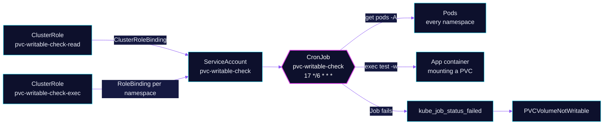

<!-- header: icon=folder-check -->
<!-- concept: From a mounted volume to a verdict on whether the app can write | list-checks Discover | terminal Test | file-check Writable | siren Verdict -->
<p align="center"></p>

> Every 6 hours, checks that each app container can write the PVC it mounts, because a Ready app can still fail to.

**Live facts:** <https://skrumbach.github.io/home-ops/apps/system/pvc-writable-check/> (workloads, routes, storage, backups, secrets and alerts, generated on every merge)

## What it does

- **Finds every container** that mounts a PVC without `readOnly: true`, from `kubectl get pods -A`.
- **Execs `test -w <mountPath>`** in each running one. If the container has no `test` binary, it retries through `sh`.
- **Fails the Job** on a clean `test -w` failure. The alert `PVCVolumeNotWritable` follows the failed Job.
- **Counts everything else as a skip**: a container that is not running, a missing shell, forbidden exec, a transient
  API error. A skip is not a pass.

## Why it is built this way

| Choice | Why |
|---|---|
| **A check, not a probe** | An app can be `Ready`, probed and Gatus-green while it cannot write its volume. Nothing else in CI sees that. The alert text names the downloads/autobrr and selfhosted/rsshub-playwright empty-volume cases found on 2026-08-30. |
| **`test -w`, not a write** | It is a read-only access check, safe against every pod, including Ceph mons and Postgres, and against mounts that are read-only. |
| **The mount path is an argv element** | It is never spliced into a shell string, so a hostile `mountPath` cannot inject anything. The `sh` fallback passes it as `$1`. |
| **No custom metric** | kube-state-metrics already exposes `kube_job_status_failed` for Jobs a CronJob creates. The script's exit code becomes the Job status, which becomes the metric. |
| **Exec bound per namespace** | It avoids a cluster-wide `pods/exec` grant ([`app/rbac.yaml`](app/rbac.yaml)). Only `get`/`list` on pods is cluster-wide; one RoleBinding per covered namespace grants exec. |
| **No `targetNamespace` on the overlay** | Flux would overwrite `metadata.namespace` on every namespaced resource, collapse the RoleBindings onto one namespace and fail with a namespace-transformation ID conflict. ServiceAccount, CronJob and PrometheusRule declare `namespace: system` instead. |

## How it works

<p align="center"></p>

<details>
<summary><b>Resource graph</b>: every object involved, by name</summary>



</details>

1. Flux applies Kustomization `pvc-writable-check`: the ServiceAccount, two ClusterRoles, the bindings, the CronJob and
   the PrometheusRule. There is no `dependsOn`.
2. The CronJob runs at minute 17 every 6 hours (`concurrencyPolicy: Forbid`, one retry, `activeDeadlineSeconds: 900`).
   An empty `kubectl get pods -A` is `FATAL`.
3. A `jq` filter lists one row per non-read-only PVC mount, and drops pods annotated
   `pvc-writable-check.home-operations.com/skip: "true"`.
4. Each row is skipped, execed or counted. Namespaces in `EXCLUDED_NAMESPACES` and containers that are not running
   are skipped before any exec. A pod that exists but is not running is no evidence the volume is unwritable.
5. An exec outcome is classed `rbac`, `transient` or `failure`. Only a clean `test -w` exit with no client or API
   error text is a failure. A timeout or an API error is inconclusive, never a failure.
6. The sweep prints a summary and exits 1 when anything is `NOT WRITABLE`.

## Settings that matter

| Setting | Value | Why |
|---|---|---|
| `schedule` | `17 */6 * * *` | Cheap enough to run often and frequent enough to catch a new permission bug within a working day. The minute avoids the many jobs at `:00`. |
| `EXCLUDED_NAMESPACES` | `rook-ceph database security` | Must match the namespaces with no `pvc-writable-check-exec` RoleBinding, so the exclusion is an API-server denial and not script-only. |
| `SKIP_ANNOTATION` | `pvc-writable-check.home-operations.com/skip` | Opt-out for a pod. The Invariants below say it is unused. |
| `backoffLimit` | `1` | A real permission bug will not fix itself on retry, and a transient failure is already a skip. |
| `ttlSecondsAfterFinished` | `172800` (48h) | Outlives the alert's `for:` window with room to investigate. |
| `failedJobsHistoryLimit` | `5` | Keeps failed Jobs for kube-state-metrics until someone has seen the alert. |
| `resources.limits.cpu` | `1000m` | A tight CFS quota throttled every run while the node was idle. The request stays `20m` because it is a standing reservation. |
| Alert `for`, and the `unless` clause | `10m`, 12h | The alert ignores a Job started 12h ago or more, so a stale failed Job stops paging. `reason!=""` selects real terminal failures, not a Job that failed once and then succeeded. |

## Operate it

```bash
flux -n system get ks pvc-writable-check
kubectl -n system get cronjob,job -l app.kubernetes.io/name=pvc-writable-check
kubectl -n system logs -l app.kubernetes.io/name=pvc-writable-check --tail=300 --since=12h | grep -A5 FAILURES
kubectl -n system get rolebinding -A | grep pvc-writable-check-exec
```

### When an alert fires

| Alert | Fires when | First look |
|---|---|---|
| `PVCVolumeNotWritable` | a sweep Job failed (with a `reason`) for 10 min | Read the Job log for `namespace/pod/claim/path`. |

## Invariants

- The alert is `kube_job_status_failed` for this CronJob's Job, with a
  non-empty `reason`. Read the Job log for `namespace/pod/claim/path`. The
  check does not write. It calls `test -w`.
- `pods/exec` is not cluster-wide. Exec is bound per namespace. `rook-ceph`,
  `database`, and `security` are excluded permanently.
- A new namespace that should be checked needs a RoleBinding in lockstep
  with the CronJob's list. The overlay must not set `targetNamespace`.
- The mount path is an argv element. Do not shell-interpolate it.
- Skips (`SKIP`, listed in the log) are not passes.

### Declaring expected read-only

[`app/cronjob.yaml`](app/cronjob.yaml) points here.

- Expected read-only is `volumeMounts[].readOnly: true` (headlamp). The skip
  annotation is unused. Do not use it to silence a real failure.

## Known gaps

- **The comment on the alert is cut off.** In [`app/prometheusrule.yaml`](app/prometheusrule.yaml) the comment above
  `PVCVolumeNotWritable` ends mid-sentence (`kube_job_status_failed{job_name=.`), so it no longer explains the
  `reason!=""` filter.
