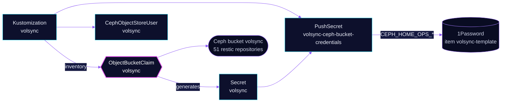

<!-- header: icon=archive -->
<!-- concept: From a retired operator to a bucket that must stay | archive Retired | shield Guarded | key-round Credentials | search Read only -->
<p align="center"></p>

> No operator any more: this Kustomization only keeps the bucket that holds the 51 retired VolSync restic repositories.

**Live facts:** <https://skrumbach.github.io/home-ops/apps/system/volsync/> (workloads, routes, storage, backups, secrets and alerts, generated on every merge)

## What it does

- **Keeps** `ObjectBucketClaim` `volsync` (bucket `volsync` on `ceph-bucket`), which holds the 51 retired restic
  repositories. The VolSync operator itself is removed (issue #2202, PR-6).
- **Keeps** `CephObjectStoreUser` `volsync` (quota 20G, 100000 objects) until retired-repository expiry has run and
  `radosgw-admin` shows it does not own the bucket.
- **Records** the bucket's S3 keys in 1Password item `volsync-template` through PushSecret
  `volsync-ceph-bucket-credentials`.
- **Runs no workload.** Nothing here schedules a backup. [kopiur](../kopiur/README.md) is the only backup engine.

## Why it is built this way

| Choice | Why |
|---|---|
| **The Kustomization keeps the name `volsync`** | Its inventory holds the OBC. Renaming or deleting it would remove the OBC from the inventory, and the `ceph-bucket` class has reclaimPolicy Delete, so deleting the claim deletes the bucket and every object in it. |
| **`prune: disabled` on the OBC and the user** | Flux then does not delete them when a manifest leaves Git or the Kustomization is removed. It does not stop `kubectl delete obc` or a namespace delete. |
| **Credentials kept in `volsync-template`** | That 1Password item also holds the only restic passwords of the 51 retired repositories. Never delete or rotate it. |
| **The user stays after the operator** | The manifest keeps it until retired-repository expiry has run (issue #2202 decision 6). It is then removed in its own PR once `radosgw-admin bucket stats --bucket=volsync` shows it does not own the bucket. |

## How it works

<p align="center"></p>

<details>
<summary><b>Resource graph</b>: every object involved, by name</summary>



</details>

1. Flux applies Kustomization `volsync` from `kubernetes/apps/base/system/volsync/backend` into namespace `system`.
   It has no `dependsOn` and no health checks.
2. Rook creates the Secret `volsync` from the OBC. The PushSecret copies its two keys into
   `CEPH_HOME_OPS_ACCESS_KEY` and `CEPH_HOME_OPS_SECRET_KEY` of `volsync-template`.
3. To read a retired repository, follow section C of the restore runbook. It reads with `restic --no-lock` into
   scratch space only. The list of the 51 repositories is `scripts/volsync-retired-expiry/ledger.yaml`.

## Settings that matter

| Setting | Value | Why |
|---|---|---|
| `kustomize.toolkit.fluxcd.io/prune` | `disabled` on the OBC and the user | See above. |
| `quotas.maxSize`, `maxObjects` | `20G`, `100000` | The kopiur user's manifest calls this quota already exceeded. The manifest records no reason for keeping it. |

## Operate it

```bash
flux -n system get ks volsync
kubectl -n system get objectbucketclaim volsync
kubectl -n system get cephobjectstoreuser volsync
kubectl -n system get pushsecret volsync-ceph-bucket-credentials
```

Reading a retired repository: [`restore.md`](../../../../../.agents/skills/incident-runbooks/references/restore.md),
section C.

## Invariants

- The 51 retired repositories outlive the operator. Their expiry is not in force.
- `paperless-ngx` is a string prefix of `paperless-ngx-media`, and `syncthing` of `syncthing-data`. A bare prefix match
  selects the sibling repository.
- Never delete the OBC, and never delete or rotate 1Password item `volsync-template`.
