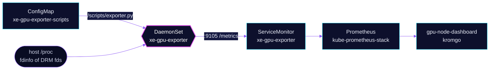

<!-- header: icon=gauge -->
<!-- concept: From GPU clients to VRAM metrics | cpu Clients | file-search Read fdinfo | sigma Sum | activity Scrape | layout-dashboard Dashboard -->
<p align="center"></p>

> Exports Arc Pro B70 VRAM use per card and per pod, read from DRM fdinfo, because the xe driver has no sysfs counter.

**Live facts:** <https://skrumbach.github.io/home-ops/apps/system/xe-gpu-exporter/> (workloads, routes, storage, backups, secrets and alerts, generated on every merge)

## What it does

- **Reads** `/proc/<pid>/fdinfo/<fd>` of every process that holds a DRM node. `drm-total-vram0` is what that client has
  resident in VRAM: weights, KV cache and compute buffers.
- **Sums** per card (`pdev`) and per pod, and serves them as Prometheus gauges on port 9105.
- **Reports capacity** from configuration, since xe exposes no total.
- **Feeds** the `ai/gpu-node-dashboard` panels and the `monitoring/kromgo` VRAM badges.

## Why it is built this way

| Choice | Why |
|---|---|
| **fdinfo, not sysfs** | xe publishes no VRAM counters in sysfs. |
| **`hostPID` plus `SYS_PTRACE`, root** | `readlink` on `/proc/<pid>/fd` must cross pod boundaries. The container is otherwise locked down: read-only root filesystem, all other capabilities dropped, no host mounts. |
| **Capacity from `XE_VRAM_TOTALS_MIB`** | xe exposes no total. The value is the Level Zero figure, not the BAR size, which is 256 MiB without Resizable BAR. |
| **A DaemonSet that ships its script in a ConfigMap** | The exporter is one stdlib Python file on a stock Python image, no image build. `reloader` restarts the pod on a change. |
| **Idle cards report 0** | An installed card with no clients is 0 bytes used, not a missing series. The exporter checks `/sys/bus/pci/devices` for the configured address. |

## How it works

<p align="center"></p>

<details>
<summary><b>Resource graph</b>: every object involved, by name</summary>



</details>

1. Flux applies Kustomization `xe-gpu-exporter`, which `dependsOn` `monitoring/kube-prometheus-stack` for the
   `ServiceMonitor` CRD. The ConfigMap is generated from `resources/exporter.py` with no name hash and with
   Flux substitution disabled.
2. On each scrape, `scan()` walks `/proc`, lists fds whose link matches `dri/renderD*` or `dri/card*`, and parses
   their fdinfo. Only `drm-driver: xe` clients count, and a (`drm-pdev`, `drm-client-id`) pair counts once.
3. The pod UID comes from the process's cgroup path. Series are labelled `pdev`, `pod_uid` and `comm`; the dashboard
   joins `pod_uid` to pod names.
4. `xe_gpu_exporter_up` is 1 when the scan completed and 0 when it raised `OSError`. `/healthz` always answers 200.

Series: `xe_gpu_vram_used_bytes`, `xe_gpu_vram_total_bytes`, `xe_gpu_gtt_used_bytes`, `xe_gpu_clients`,
`xe_gpu_process_vram_bytes`, `xe_gpu_process_gtt_bytes`, `xe_gpu_exporter_up`.

## Settings that matter

| Setting | Value | Why |
|---|---|---|
| `XE_VRAM_TOTALS_MIB` | `0000:03:00.0=32656` | Capacity per PCI address. Add a second card here when it exists. |
| `PORT` | `9105` | Metrics and probe port. |
| `hostPID` | `true` | See every pod's processes. |
| `securityContext` | `runAsUser: 0`, `SYS_PTRACE` only, read-only root filesystem | `readlink` across pods needs both. |
| `automountServiceAccountToken` | `false` | The exporter never calls the API. |
| `tolerations` | `home-operations.com/dedicated` `PreferNoSchedule` | Hygiene. `PreferNoSchedule` does not filter, and talos-3 is the only node with the B70. |
| `resources` | 10m CPU; 32Mi request, 128Mi limit | Every limit has a request. |

## Operate it

```bash
flux -n system get ks xe-gpu-exporter
kubectl -n system get ds,pod -l app.kubernetes.io/name=xe-gpu-exporter -o wide
kubectl -n system logs ds/xe-gpu-exporter --tail=20
# Metrics straight from the pod (needs exec; the image has python only):
kubectl -n system exec ds/xe-gpu-exporter -- python3 -c "import urllib.request as u; print(u.urlopen('http://127.0.0.1:9105/metrics').read().decode())"
```

Upstream: [DRM client usage stats (fdinfo)](https://docs.kernel.org/gpu/drm-usage-stats.html)
