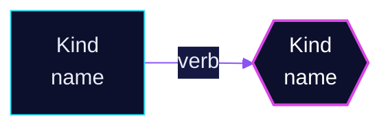

# scripts/docs

`build.py` writes the documentation site's content tree from the repository, so every merge
documents itself and no page is maintained by hand. The Hugo theme in `docs/` renders it.

Reads:

- the cluster as `flate build all --path kubernetes/clusters/main -o json` renders it
  (run through `mise exec --` when `flate` is not on PATH; Secrets and CRDs are skipped);
- the overlay files `kubernetes/apps/main/<ns>/<app>.yaml`: one file is one app, and its Flux
  Kustomizations give the paths, `dependsOn`, components and substitutions;
- `.renovaterc.json5` and `.renovate/*.json5`;
- a fixed list of hand-written Markdown (`OPS_ORDER`, `OPS_REST`, the runbooks, `terraform/`), plus every
  `README.md`/runbook under `kubernetes/apps/base/<ns>/<app>/` (shown on that app's page) and
  `kubernetes/apps/base/<ns>/README.md` (shown on the namespace page).

Writes `docs/.build/content/` (deleted and recreated every run, gitignored): `apps/`, `reference/`,
`operations/` and the home page, Markdown with front matter only. Images the Markdown shows are copied to
`docs/.build/static/files/<repo path>`, so the site serves them itself. The same commit always gives the
same bytes: everything is sorted and the only date is the commit date.

The site is public. The script publishes names only: no Secret data, no ExternalSecret templates,
no env values, no ConfigMap contents.

Run:

```bash
uv run --script scripts/docs/build.py                      # renders with flate, a few seconds once cached
uv run --script scripts/docs/build.py --rendered FILE      # reuse a render (JSON or YAML)
task docs:serve                                            # build, then hugo server
```

Flags: `--out DIR`, `--repo OWNER/NAME` (default `$GITHUB_REPOSITORY`, then `origin`), `--branch main`.

Add a hand-written page: put the Markdown next to what it describes. Under
`kubernetes/apps/base/<ns>/<app>/` it lands on that app's page with no change here; anywhere else,
add its path to `OPS_REST` in `build.py`. The first `# ` heading becomes the title, and relative links
are rewritten to site pages or GitHub.

## App READMEs

Every app has one `README.md` in `kubernetes/apps/base/<ns>/<app>/`, in the shape below. It holds what a
manifest cannot say: what the app is for here, why it is set up this way, how it works, how to operate
it. Tables of workloads, routes, storage, backups, secrets and alert names are not written by hand; the
site generates them on every merge. The worked examples are `cert-manager/cert-manager`,
`home-automation/home-assistant` and `kube-system/cilium`.

````markdown
<!-- header: icon=shield-check -->
<!-- concept: From a DNS proof to a certificate | key-round Token | file-key Request | globe Prove | badge-check Sign | shield-check Serve -->
<p align="center"></p>

> One sentence, at most 120 characters, that says what the app does for this cluster.

**Live facts:** <https://skrumbach.github.io/home-ops/apps/NS/APP/> (workloads, routes, storage, backups, secrets and alerts, generated on every merge)

## What it does

- **Verb** one capability, with the real object names. Three to six bullets.

## Why it is built this way

| Choice | Why |
|---|---|
| **This, not that** | The reason, the alternative, what breaks otherwise. |

## How it works

<p align="center"></p>

<details>
<summary><b>Resource graph</b>: every object involved, by name</summary>



</details>

1. Numbered steps: what Flux applies, then the runtime path, with the reason for anything not obvious.

## Settings that matter

| Setting | Value | Why |
|---|---|---|
| `key.path` | `value` | Why this value and what the default would do. |

## Operate it

```bash
flux -n NS get ks APP
```

### When an alert fires

| Alert | Fires when | First look |
|---|---|---|

## Invariants

- Rules that must hold. One carried over from an older README keeps its wording.

## Known gaps

- **Short title.** What is wrong, where, and its effect.

Upstream: [project docs](https://example.org)
````

Rules:

- **Order and names are fixed.** `What it does`, `How it works`, `Settings that matter` and `Operate it` are
  always there; `Why it is built this way`, `When an alert fires`, `Invariants` and `Known gaps` only when they
  have content. No `# ` title: the header is the title.
- **The tagline** is one sentence in a `>` line. The site uses it as the app's description on every table.
- **Facts come from Git.** Every value in a table is read from a manifest, never remembered. No chart or
  image versions (Renovate owns them). Secrets by 1Password item and Secret name only. A mismatch found
  while writing goes into `Known gaps`; it is not fixed in the README change.
- **Settings that matter** lists values that differ from the chart default or encode a decision. It is not
  a values dump. When no manifest gives the reason for a value, say so instead of inventing one.
- **When an alert fires** covers the alerts about this app, wherever their rule is defined.
- **Operate it** holds commands that only read. Mark the ones that need `exec`.
- **Length follows the app:** about 50 lines for a single-container app, up to about 180 for a platform
  component.
- **Mermaid:** the `init` line and the two classes above, `accent` for the one object the app is about,
  `ext` for things outside the cluster. No subgraphs and no `fontFamily`: both break on GitHub.

### The two pictures

`scripts/docs/pictures.py` draws them from the two comments at the top of the README and writes them next
to it. Run it after changing a comment (`task docs:pictures`); never edit an SVG by hand.

- **`header.svg`** shows the namespace, the app name and one [Lucide](https://lucide.dev/icons) icon
  (release 0.460.0). Nothing else, so it only changes when the app is renamed or the icon changes.
  Without a `header` comment the app gets its namespace's icon.
- **`concept.svg`** shows three to six stations, each `<icon> <label>`, after a short title. Labels are
  one or two concept words (`Token`, `Request`), never an object name or a value: the Mermaid graph
  carries the names. Leave the comment and the `` out when the app has no flow worth drawing.
- Both are dark cards in the site's palette and type, with slow CSS-only motion that stops under
  `prefers-reduced-motion`. Text is drawn as outlines because GitHub blocks fonts inside an image.
- `pictures.py --check` lists pictures that are missing or older than their comment.

### On the site

`build.py` recognises a README in this shape by its `header.svg` image. It takes the tagline as the app's
description, drops the header, the comments and the `Live facts` line (the page head already shows the
same design), and puts the rest at the top of the app's page, above the generated sections. A README
without the header is shown under `Notes` as before. Images are copied into the site.
